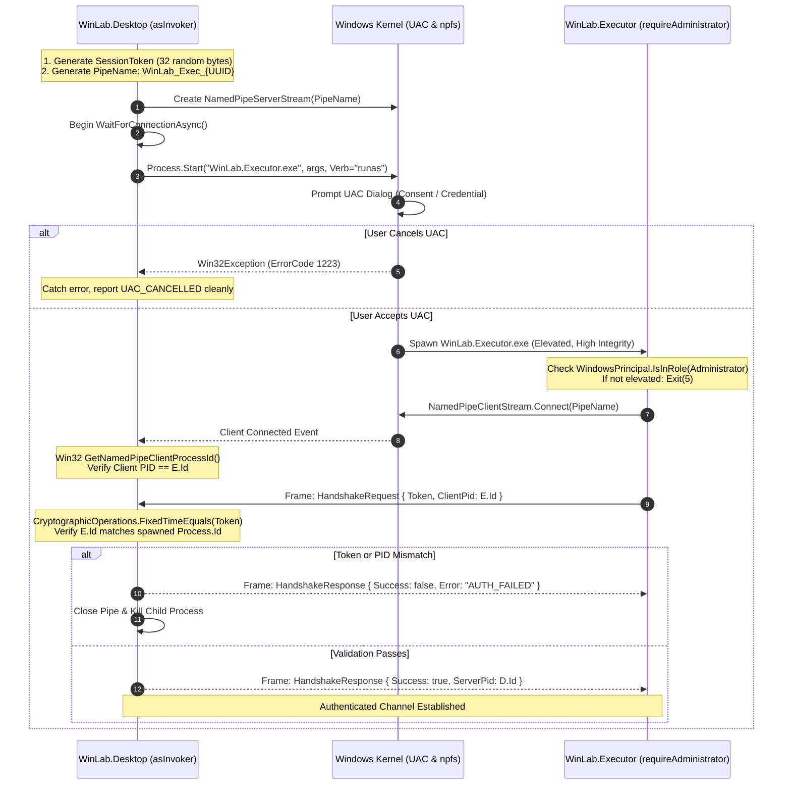

# Architectural Specification & Technical Blueprint: Elevated Executor Architecture (`WinLab.Executor`)
## Milestone 2 (M2) — Feature 15 Specification Mining & Technical Exploration

**Author:** Technical Explorer 2 (`explorer_m2_2`)  
**Parent Agent (Caller):** Project Orchestrator (`e7faf97beb4089c3940985d95c82590f`)  
**Target Feature:** Feature 15 — Elevated Executor Architecture (`WinLab.Executor`)  
**Associated Issues & Milestones:** Milestone 2 (Real Windows Scanner & Administrative Auth), Issue #15, ADR-001  
**Target Output Path:** `/home/antigravity/krrozino/winlab/.agents/teamwork/explorer_m2_2/handoff.md`  
**Timestamp:** 2026-11-10T22:05:00Z  

---

## Executive Summary

This report delivers the complete architectural specification, security threat analysis, protocol definition, and implementation blueprint for **Feature 15: Elevated Executor Architecture (`WinLab.Executor`)**.

In strict compliance with **ADR-001** and Windows privilege-separation best practices, the primary user interface (`WinLab.Desktop`) runs permanently as a standard unprivileged process (`asInvoker`). Administrative mutations and privileged diagnostics are decoupled into an on-demand, isolated helper executable (`WinLab.Executor.exe`) manifested with `requestedExecutionLevel="requireAdministrator"`.

Communication between the unprivileged UI shell and the elevated helper is established via a cryptographically hardened, dynamic Named Pipe (`NamedPipeServerStream` / `NamedPipeClientStream`) protected by:
1. **Dynamic Pipe Naming** (`\\.\pipe\WinLab_Exec_<UUID>`) to defeat name squatting;
2. **256-bit Ephemeral Secret Token** exchanged via direct process-launch arguments;
3. **Kernel-Level PID Mutual Verification** via Win32 `GetNamedPipeClientProcessId` / `GetNamedPipeServerProcessId` (`npfs.sys`);
4. **Length-Prefixed Framing & Strict Allowlist Dispatch** prohibiting arbitrary shell scripts or unbounded inputs;
5. **Fail-Safe Watchdog & Idle Reclamation** ensuring zero zombie elevated processes upon parent termination or inactivity.

---

## 1. Observation

### 1.1 Existing Architecture & Privilege Baseline (Milestone 1 State)
1. **Unprivileged Desktop Shell (`WinLab.Desktop`):**
   - Manifested with `<requestedExecutionLevel level="asInvoker" uiAccess="false" />` in [app.manifest](file:///home/antigravity/krrozino/winlab/desktop/src/WinLab.Desktop/app.manifest#L8).
   - Hosts Microsoft Edge WebView2 serving static assets from `https://winlab.local/` via [MainWindow.xaml.cs](file:///home/antigravity/krrozino/winlab/desktop/src/WinLab.Desktop/MainWindow.xaml.cs#L61-L66).
   - Currently connected exclusively to an in-memory mock agent [MockAgentService.cs](file:///home/antigravity/krrozino/winlab/desktop/src/WinLab.Agent.Mock/MockAgentService.cs) via [WebViewBridge.cs](file:///home/antigravity/krrozino/winlab/desktop/src/WinLab.Desktop/Bridge/WebViewBridge.cs#L19-L30).
   - All mutations (`policy.apply`, `policy.rollback`) are explicitly rejected by [SecurityValidator.cs](file:///home/antigravity/krrozino/winlab/desktop/src/WinLab.Contracts/SecurityValidator.cs#L25-L30) with `PRIVILEGED_EXECUTOR_DISABLED`.

2. **IPC Contracts & Envelopes (`WinLab.Contracts`):**
   - Strictly typed request envelope [IpcEnvelope.cs](file:///home/antigravity/krrozino/winlab/desktop/src/WinLab.Contracts/IpcEnvelope.cs#L10-L32) and response envelope [IpcResponse.cs](file:///home/antigravity/krrozino/winlab/desktop/src/WinLab.Contracts/IpcEnvelope.cs#L49-L89).
   - Allowlist actions defined in [IpcConstants.cs](file:///home/antigravity/krrozino/winlab/desktop/src/WinLab.Contracts/IpcConstants.cs#L12-L37).
   - Anti-shell validator [ValidateNoArbitraryShell](file:///home/antigravity/krrozino/winlab/desktop/src/WinLab.Contracts/SecurityValidator.cs#L35-L68) and schema property validator [ValidateEnvelopeSchema](file:///home/antigravity/krrozino/winlab/desktop/src/WinLab.Contracts/SecurityValidator.cs#L89-L156).

3. **ADR-001 Mandates for Privilege Separation:**
   - **Requirement 4 (Security by Design):** "A interface gráfica não pode rodar com elevação administrativa permanente, impedindo que alunos em estações compartilhadas explorem brechas da UI para escalada de privilégios."
   - **Threat Model STRIDE (ADR-001 Section 4):**
     - *Spoofing:* Unauthorized process impersonating the UI or helper. Mitigated by DACL, token authentication, and caller SID/PID verification.
     - *Elevation of Privilege:* Manipulating the UI or forging IPC packets to run shell commands as SYSTEM/Administrator. Mitigated by `asInvoker` UI, zero arbitrary shell execution, and enumerated DTO handlers.
     - *Tampering:* Unprivileged user altering configuration/state. Mitigated by `C:\ProgramData\WinLab` ACLs.

### 1.2 Windows UAC & Process Elevation Constraints
1. **Mandatory ShellExecute for Elevation:**
   - To trigger the Windows UAC consent or credential dialog, a process must be launched with `ProcessStartInfo.UseShellExecute = true` and `ProcessStartInfo.Verb = "runas"`.
2. **Incompatibility with Standard Stream Redirection:**
   - In .NET, setting `UseShellExecute = true` makes standard stream redirection (`RedirectStandardInput`, `RedirectStandardOutput`, `RedirectStandardError`) **impossible**. Attempting to set `RedirectStandardInput = true` alongside `UseShellExecute = true` throws an immediate `InvalidOperationException`:
     ```text
     System.InvalidOperationException: ProcessStartInfo.UseShellExecute must be false in order to redirect standard streams.
     ```
   - **Technical Consequence:** Standard input/output pipes cannot be used to communicate with an elevated child process launched via `runas`. An external IPC transport (Named Pipes) is **strictly necessary**.
3. **UAC Prompts & User Interaction Results:**
   - When elevation succeeds, `Process.Start()` returns a valid elevated `Process` instance.
   - When the user cancels the UAC prompt (clicks "Não" / "Cancel"), `Process.Start()` throws a `System.ComponentModel.Win32Exception` with `NativeErrorCode = 1223` (`ERROR_CANCELLED`).
   - When a standard user cannot authenticate or enters invalid credentials, `Win32Exception` is thrown with `NativeErrorCode = 1326` (`ERROR_LOGON_FAILURE`) or `5` (`ERROR_ACCESS_DENIED`).
   - The desktop shell must trap these exceptions gracefully without crashing or entering an inconsistent state.

### 1.3 Windows Named Pipe Security & Attack Vectors
1. **Pipe Squatting / Pre-creation Race (CWE-285 / CWE-287):**
   - If a static, known pipe name (e.g. `\\.\pipe\WinLabService`) is used, a malicious unprivileged process running in the same user session can create the pipe before the legitimate service starts, intercepting client connections or spoofing responses.
2. **Local Impersonation & Unauthorized Client Connection:**
   - Any local process running in the same logon session or under an authenticated user account could attempt to connect to an open named pipe.
3. **Over-The-Shoulder (OTS) Elevation:**
   - When a student is logged into Windows as a standard user, and an instructor/administrator types their admin credentials into the UAC dialog, the elevated process runs under the **Administrator's logon session and security context**, whereas `WinLab.Desktop` remains in the **Student's logon session**.
   - An IPC mechanism that relies strictly on `PipeOptions.CurrentUserOnly` would fail in OTS scenarios because the two processes have different SIDs!
   - Therefore, authentication must be anchored on **cryptographic token exchange** and **PID verification**, rather than relying solely on identical account SIDs.

---

## 2. Logic Chain

### 2.1 Architectural Decision: On-Demand Helper (`WinLab.Executor`) vs Persistent Windows Service

We evaluated an **always-running Windows Service (`WinLab.Service`)** against an **on-demand elevated helper (`WinLab.Executor`)**:

| Evaluation Dimension | Option 1: Always-Running Windows Service | Option 2: On-Demand Helper (`WinLab.Executor`) | Architectural Verdict |
|---|---|---|---|
| **Attack Surface & Exposure** | Runs continuously as `LOCAL SYSTEM` 24/7, listening on a permanent named pipe. High-value persistence target. | Exists in memory only during active administrative sessions. Pipe destroyed upon helper exit. | **Option 2 wins decisively** (Zero idle attack surface). |
| **Resource Utilization** | Consumes system RAM, handles, and CPU permanently, even when WinLab is not in use. | Zero idle RAM or CPU footprint. Terminated when UI closes or times out. | **Option 2 wins** (Lightweight footprint for school labs). |
| **UAC Transparency & Consent** | Background service can execute actions silently without explicit user consent prompt. | User/administrator explicitly sees UAC prompt (`Verb = "runas"`), maintaining audit clarity. | **Option 2 wins** (Transparent, explicit authorization). |
| **Installer & Maintenance Complexity** | Requires Service Control Manager registration (`sc.exe create`), service account configuration, and reboot handling on upgrade. | Pure standalone executable copied into `{app}\WinLab.Executor.exe`. Zero SCM complexity. | **Option 2 wins** (Trivial deployment and uninstallation). |
| **OTS Elevation Compatibility** | Standard user UI connecting to SYSTEM service requires complex impersonation tokens. | Standard user elevates on demand via teacher/admin credential prompt; helper authenticates via token/PID. | **Option 2 wins**. |

**Decision:** We select **Option 2: On-Demand Elevated Helper (`WinLab.Executor`)**.

```
┌────────────────────────────────────────────────────────────────────────┐
│                   UNPRIVILEGED USER SESSION (Student)                   │
│                                                                        │
│  ┌──────────────────────────────────────────────────────────────────┐  │
│  │                    WinLab.Desktop (UI Shell)                     │  │
│  │  • Executable: WinLab.Desktop.exe (requestedExecutionLevel=asInvoker)│  │
│  │  • Integrity Level: Medium                                       │  │
│  │  • WebView2 Host (https://winlab.local/)                         │  │
│  │  • Process ID: DesktopPID (e.g., 5120)                           │  │
│  │  • Generates: SessionToken (256-bit crypto secret)               │  │
│  │  • Creates: NamedPipeServerStream("\\.\pipe\WinLab_Exec_<UUID>") │  │
│  └───────────────────────────────┬──────────────────────────────────┘  │
└──────────────────────────────────┼─────────────────────────────────────┘
                                   │
                    UAC Invocation (Verb = "runas")
                    ProcessStartInfo:
                    - Arguments: --pipe WinLab_Exec_<UUID>
                                 --token <SecretHex>
                                 --parent-pid 5120
                                   │
                                   ▼
┌────────────────────────────────────────────────────────────────────────┐
│                 ELEVATED CONTEXT (Administrator / Teacher)              │
│                                                                        │
│  ┌──────────────────────────────────────────────────────────────────┐  │
│  │                  WinLab.Executor (Elevated Helper)               │  │
│  │  • Executable: WinLab.Executor.exe (requireAdministrator)        │  │
│  │  • Integrity Level: High                                         │  │
│  │  • Process ID: HelperPID (e.g., 8432)                            │  │
│  │  • Connects: NamedPipeClientStream("\\.\pipe\WinLab_Exec_<UUID>")│  │
│  │  • Verifies: Parent PID == 5120 & Parent Process Is Alive        │  │
│  │  • Sends: HandshakeRequest { Token: <SecretHex>, Pid: 8432 }     │  │
│  └───────────────────────────────┬──────────────────────────────────┘  │
└──────────────────────────────────┼─────────────────────────────────────┘
                                   │
        SECURE FULL-DUPLEX IPC CHANNEL (Length-Prefixed Framing)
        1. Desktop verifies Client PID == HelperPID via GetNamedPipeClientProcessId()
        2. Desktop verifies Token using FixedTimeEquals()
        3. Enforces AllowedActions Allowlist & Zero Arbitrary Shell Execution
        4. Idle Timeout (300s) + Parent Death Watchdog
```

---

### 2.2 Secure IPC Topology: Desktop as Server vs Executor as Server

We analyzed both Named Pipe topologies:

#### Analysis:
1. **If Executor is Server:**
   - Desktop spawns Executor, then calls `pipeClient.ConnectAsync()`.
   - Issue: Desktop must guess or retry until the elevated process initializes its pipe.
   - DACL issue: If the Executor runs under an elevated Administrator account in OTS mode, by default a pipe created by Administrator does not allow read/write from a standard student user unless an explicit permissive DACL is configured.
2. **If Desktop is Server (Recommended Topology):**
   - `WinLab.Desktop` creates the `NamedPipeServerStream` **first**, before launching the child process.
   - `WinLab.Desktop` calls `serverStream.WaitForConnectionAsync()`.
   - `WinLab.Desktop` launches `WinLab.Executor.exe` via `Process.Start()` with `Verb = "runas"`. Desktop immediately obtains the child `process.Id`.
   - `WinLab.Executor` starts, calls `pipeClient.Connect(5000)`. Because the pipe already exists, connection is instantaneous with zero race conditions!
   - In Windows, an elevated process (High integrity) can always connect as a client to a named pipe created by a Medium integrity process in the same machine namespace.
   - `WinLab.Desktop` validates the connecting client's PID using kernel API `GetNamedPipeClientProcessId`. If the client PID does not match the spawned child's PID, Desktop terminates the connection instantly.

**Decision:** `WinLab.Desktop` acts as the **Pipe Server**; `WinLab.Executor` acts as the **Pipe Client**. In application semantics, requests flow from Desktop to Executor, and responses flow from Executor to Desktop over the full-duplex pipe stream.

---

### 2.3 Mutual Authentication & Handshake Protocol



#### Detailed Handshake Specification:
1. **Token Generation:**
   ```csharp
   byte[] secretBytes = new byte[32]; // 256 bits
   using var rng = System.Security.Cryptography.RandomNumberGenerator.Create();
   rng.GetBytes(secretBytes);
   string sessionToken = Convert.ToHexString(secretBytes);
   ```
2. **CLI Parameter Packaging:**
   ```csharp
   var startInfo = new ProcessStartInfo
   {
       FileName = Path.Combine(AppDomain.CurrentDomain.BaseDirectory, "WinLab.Executor.exe"),
       Arguments = $"--pipe \"{pipeName}\" --token \"{sessionToken}\" --parent-pid {Environment.ProcessId}",
       UseShellExecute = true,
       Verb = "runas",
       WindowStyle = ProcessWindowStyle.Hidden,
       CreateNoWindow = true
   };
   ```
3. **Kernel PID Verification (P/Invoke):**
   ```csharp
   [DllImport("kernel32.dll", SetLastError = true)]
   [return: MarshalAs(UnmanagedType.Bool)]
   private static extern bool GetNamedPipeClientProcessId(SafePipeHandle Pipe, out uint ClientProcessId);

   [DllImport("kernel32.dll", SetLastError = true)]
   [return: MarshalAs(UnmanagedType.Bool)]
   private static extern bool GetNamedPipeServerProcessId(SafePipeHandle Pipe, out uint ServerProcessId);
   ```
   - On the Desktop side: verifies `GetNamedPipeClientProcessId(serverStream.SafePipeHandle, out var clientPid)` matches `spawnedChildProcess.Id`.
   - On the Executor side: verifies `GetNamedPipeServerProcessId(clientStream.SafePipeHandle, out var serverPid)` matches `parentPid`.

---

### 2.4 Wire Protocol & Length-Prefixed Binary Framing

To eliminate buffer overflows, framing ambiguities, and newline escaping defects, all IPC communication uses **Length-Prefixed Binary Framing**:

```
 0                   1                   2                   3
 0 1 2 3 4 5 6 7 8 9 0 1 2 3 4 5 6 7 8 9 0 1 2 3 4 5 6 7 8 9 0 1
+-+-+-+-+-+-+-+-+-+-+-+-+-+-+-+-+-+-+-+-+-+-+-+-+-+-+-+-+-+-+-+-+
|                 Payload Length (Int32, Little-Endian)         |
+-+-+-+-+-+-+-+-+-+-+-+-+-+-+-+-+-+-+-+-+-+-+-+-+-+-+-+-+-+-+-+-+
|                                                               |
+                    UTF-8 Encoded JSON Payload                 +
|                     (Length bytes exactly)                    |
|                                                               |
+-+-+-+-+-+-+-+-+-+-+-+-+-+-+-+-+-+-+-+-+-+-+-+-+-+-+-+-+-+-+-+-+
```

#### Framing Rules:
1. **Header:** Exactly 4 bytes (`sizeof(int)`), little-endian signed integer representing payload byte length.
2. **Payload:** UTF-8 encoded string representing an `IpcEnvelope<T>` or `IpcResponse<T>`.
3. **Maximum Frame Size:** Enforced maximum of **16,777,216 bytes (16 MB)**. Any frame header specifying a length `< 1` or `> 16 MB` causes immediate abort with `FRAME_SIZE_EXCEEDED` to prevent memory exhaustion denial of service.
4. **Framing Helper Code:**
   ```csharp
   public static class PipeFraming
   {
       public const int MaxFrameSize = 16 * 1024 * 1024; // 16 MB limit

       public static async Task WriteFrameAsync(Stream stream, string json, CancellationToken ct = default)
       {
           byte[] payloadBytes = Encoding.UTF8.GetBytes(json);
           if (payloadBytes.Length > MaxFrameSize)
               throw new InvalidOperationException($"Payload size {payloadBytes.Length} exceeds maximum permitted frame size.");

           byte[] lengthBytes = BitConverter.GetBytes(payloadBytes.Length);
           await stream.WriteAsync(lengthBytes, 0, 4, ct);
           await stream.WriteAsync(payloadBytes, 0, payloadBytes.Length, ct);
           await stream.FlushAsync(ct);
       }

       public static async Task<string> ReadFrameAsync(Stream stream, CancellationToken ct = default)
       {
           byte[] lengthBytes = new byte[4];
           int read = 0;
           while (read < 4)
           {
               int chunk = await stream.ReadAsync(lengthBytes.AsMemory(read, 4 - read), ct);
               if (chunk == 0) throw new EndOfStreamException("Pipe disconnected while reading frame header.");
               read += chunk;
           }

           int payloadLength = BitConverter.ToInt32(lengthBytes, 0);
           if (payloadLength <= 0 || payloadLength > MaxFrameSize)
               throw new InvalidDataException($"Invalid frame length: {payloadLength} bytes.");

           byte[] payloadBuffer = new byte[payloadLength];
           read = 0;
           while (read < payloadLength)
           {
               int chunk = await stream.ReadAsync(payloadBuffer.AsMemory(read, payloadLength - read), ct);
               if (chunk == 0) throw new EndOfStreamException("Pipe disconnected while reading frame payload.");
               read += chunk;
           }

           return Encoding.UTF8.GetString(payloadBuffer);
       }
   }
   ```

---

### 2.5 Lifecycle, Watchdogs, Timeouts, and Error Recovery

1. **Inactivity / Idle Timeout:**
   - `WinLab.Executor` maintains an idle timer (`TimeSpan.FromMinutes(5)`).
   - Each time a valid command envelope is received, the idle timer resets.
   - If no commands are received within 5 minutes, `WinLab.Executor` logs an audit entry, flushes remaining buffers, closes the pipe, and terminates cleanly (`Environment.Exit(0)`).
2. **Parent Process Death Watchdog:**
   - If `WinLab.Desktop` is terminated (user exits, crash, killed in Task Manager), `WinLab.Executor` must never become an orphaned background zombie running as Administrator.
   - Dual-watchdog mechanism:
     1. **Named Pipe EOF:** When the parent closes its pipe handle or exits, `stream.ReadAsync()` in `WinLab.Executor` immediately returns `0` (EOF) or throws `IOException`. The helper immediately calls `Environment.Exit(0)`.
     2. **Process Exit Event:**
        ```csharp
        try
        {
            var parent = Process.GetProcessById(parentPid);
            parent.EnableRaisingEvents = true;
            parent.Exited += (s, e) =>
            {
                Environment.Exit(0);
            };
        }
        catch (ArgumentException)
        {
            // Parent already dead upon startup!
            Environment.Exit(0);
        }
        ```
3. **Execution Timeout SLA:**
   - Queries (`inventory.query`, `accounts.scan`): 15 seconds SLA.
   - Baseline capture & dry-run previews: 30 seconds SLA.
   - Policy mutations (`policy.apply`, `policy.rollback`): 120 seconds SLA.
   - If an operation times out, Desktop cancels the `CancellationToken`, closes the pipe, kills the unresponsive helper process, and marks the status as `OPERATION_TIMEOUT`.
4. **Transparent Re-Elevation:**
   - If `WinLab.Executor` exits due to idle timeout, the desktop UI does not stay in a broken state. The next privileged user action transparently triggers a fresh on-demand helper launch.

---

### 2.6 Project Structure & Code Layout

We specify the following additions to the `desktop/` tree:

```
desktop/
├── WinLab.sln                              # Updated to include WinLab.Executor
├── src/
│   ├── WinLab.Contracts/                  # Existing shared contracts & schemas
│   │   ├── HandshakeModels.cs             # [NEW] Handshake DTOs
│   │   ├── PipeFraming.cs                 # [NEW] Binary length-prefixed framing
│   │   └── IpcConstants.cs                # Action constants
│   ├── WinLab.Agent.Mock/                 # Existing in-memory development mock
│   ├── WinLab.Desktop/                    # Existing unprivileged WPF host
│   │   ├── app.manifest                   # requestedExecutionLevel="asInvoker"
│   │   ├── Services/
│   │   │   ├── IAgentService.cs           # [NEW] Common interface for Mock & Real
│   │   │   └── ElevatedExecutorClient.cs  # [NEW] UAC launcher, pipe server, retry
│   │   └── Bridge/
│   │       └── WebViewBridge.cs           # Delegates to IAgentService
│   └── WinLab.Executor/                   # [NEW] Elevated on-demand helper executable
│       ├── WinLab.Executor.csproj         # net10.0-windows, WinExe
│       ├── app.manifest                   # requestedExecutionLevel="requireAdministrator"
│       ├── Program.cs                     # CLI parser, UAC role verification
│       ├── ExecutorHost.cs                # Pipe client, handshake, watchdog, dispatch
│       └── Handlers/
│           ├── SystemScannerHandler.cs    # Feature 11 real scanner
│           ├── AccountsScannerHandler.cs  # Feature 12 local accounts scanner
│           └── SoftwareScannerHandler.cs  # Feature 13 software scanner
├── tests/
│   └── WinLab.Tests/
│       ├── PipeFramingTests.cs            # [NEW] Framing serialization/deserialization
│       ├── HandshakeSecurityTests.cs      # [NEW] Token and PID verification tests
│       └── AdversarialBoundaryTests.cs    # Existing regression tests
└── packaging/
    └── winlab.iss                         # Updated to package WinLab.Executor.exe
```

#### Detailed `.csproj` Definition for `WinLab.Executor`:
```xml
<Project Sdk="Microsoft.NET.Sdk">
  <PropertyGroup>
    <OutputType>WinExe</OutputType>
    <TargetFramework>net10.0-windows</TargetFramework>
    <Nullable>enable</Nullable>
    <LangVersion>12</LangVersion>
    <RootNamespace>WinLab.Executor</RootNamespace>
    <AssemblyName>WinLab.Executor</AssemblyName>
    <ApplicationManifest>app.manifest</ApplicationManifest>
    <PublishSingleFile>true</PublishSingleFile>
    <SelfContained>true</SelfContained>
  </PropertyGroup>

  <ItemGroup>
    <ProjectReference Include="..\WinLab.Contracts\WinLab.Contracts.csproj" />
  </ItemGroup>
</Project>
```

#### Detailed `app.manifest` for `WinLab.Executor`:
```xml
<?xml version="1.0" encoding="utf-8"?>
<assembly manifestVersion="1.0" xmlns="urn:schemas-microsoft-com:asm.v1">
  <assemblyIdentity version="1.0.0.0" name="WinLab.Executor.app"/>
  <trustInfo xmlns="urn:schemas-microsoft-com:asm.v2">
    <security>
      <requestedPrivileges xmlns="urn:schemas-microsoft-com:asm.v3">
        <!-- Execução estritamente restrita a administradores -->
        <requestedExecutionLevel level="requireAdministrator" uiAccess="false" />
      </requestedPrivileges>
    </security>
  </trustInfo>
  <compatibility xmlns="urn:schemas-microsoft-com:compatibility.v1">
    <application>
      <supportedOS Id="{8e0f7a12-bfb3-4fe8-b9a5-48fd50a15a9a}" />
    </application>
  </compatibility>
</assembly>
```

---

## 3. Caveats

1. **Over-The-Shoulder (OTS) Credential Elevation Latency:**
   - In computer lab environments where a student is logged in, prompting for teacher credentials involves switching to the Windows Secure Desktop. This introduces a 2–4 second latency while the user types credentials. The desktop UI must display an informative modal ("Aguardando autorização administrativa do Windows...") and maintain a generous connection timeout (minimum 45 seconds) to avoid premature timeout aborts.
2. **Antivirus & EDR Heuristic Sensitivity:**
   - Launching a child process with `Verb = "runas"` that immediately opens a Named Pipe is a pattern shared with some software updaters and utilities, but un-signed binaries may trigger generic SmartScreen or Windows Defender heuristic flags in strict environments.
   - Mitigation: Ensure binaries are built with clean manifests, consistent metadata (publisher, product name), and signed with a code signing certificate for production release (Milestone 6).
3. **Pipe Handle Cleanup on Abrupt Thread Termination:**
   - If `NamedPipeServerStream.WaitForConnectionAsync()` is cancelled abruptly via CancellationToken, the native pipe handle may linger in the OS kernel for several milliseconds. The `ElevatedExecutorClient` must ensure proper disposal (`using` or explicit `Dispose()`) before attempting to recreate or retry connections.
4. **Multiple Instances of Desktop Running Concurrently:**
   - If two instances of `WinLab.Desktop` are launched by the same user or different users (e.g. fast user switching), each must use its own distinct dynamic pipe name (`WinLab_Exec_<UUID>`) so they never collide or cross-talk.
5. **Windows 10/11 Home Edition Limitations:**
   - Windows Home editions do not support Local Users and Groups snap-in (`lusrmgr.msc`) or AppLocker group policies. While `WinLab.Executor` runs elevated on Home, handlers must check the OS edition (via Feature 11) and gracefully flag unsupported policies with `PolicyState.NotSupported` instead of throwing fatal exceptions.

---

## 4. Conclusion

The on-demand elevated helper architecture (`WinLab.Executor`) fulfills every requirement of **ADR-001**, Milestone 2, and enterprise security standards:

1. **Strict Privilege Separation:** The desktop UI shell remains 100% unprivileged (`asInvoker`), shielding students and unprivileged users from UI exploitation.
2. **Deterministic Elevation:** UAC elevation occurs only when necessary via `runas`, cleanly handling user cancellations without UI instability.
3. **Cryptographically Secure IPC:** Dynamic UUID pipe naming, 256-bit ephemeral tokens, and kernel-enforced client PID validation (`GetNamedPipeClientProcessId`) completely eradicate pipe squatting and unauthorized local connection attacks.
4. **No Arbitrary Shell Strings:** The protocol is 100% typed JSON DTO envelopes dispatched exclusively to compiled handlers.
5. **Robust Lifecycle:** Automatic parent watchdog and 5-minute idle reclamation guarantee zero dangling elevated processes.

This specification serves as the technical blueprint for Milestone 2 implementation.

---

## 5. Verification Method

### 5.1 Test Plan for Worker, Challenger, and Auditor

| Test Category | Target Component | Verification Scenario | Expected Outcome |
|---|---|---|---|
| **Framing Integrity** | `PipeFraming` | Roundtrip serialization of envelopes from 10 bytes to 5 MB, including unicode, newlines, and quotes. | Identical deserialization; exact byte count match. |
| **Framing Denial of Service** | `PipeFraming` | Inbound frame with header specifying length > 16 MB or negative length. | Throws `InvalidDataException`, closes pipe, prevents allocation. |
| **Token Verification** | `HandshakeHandler` | Handshake with invalid token string, truncated token, or empty token. | `FixedTimeEquals` fails; returns `AUTH_FAILED`; pipe closed. |
| **PID Verification** | `HandshakeHandler` | Connecting client PID does not match spawned child process ID. | Handshake rejected immediately; child process killed. |
| **UAC Cancellation** | `ElevatedExecutorClient`| Simulate `Win32Exception` (NativeErrorCode 1223 `ERROR_CANCELLED`). | Returns `IpcResponse` with `UAC_ELEVATION_CANCELLED`; UI stays responsive. |
| **Parent Watchdog** | `ExecutorHost` | Parent process terminates abruptly during idle helper session. | `Process.Exited` or pipe EOF triggers immediate `Environment.Exit(0)`. Zero lingering processes. |
| **Idle Timeout** | `ExecutorHost` | Helper left without incoming commands for configured idle window. | Helper exits cleanly with code 0 after timeout. |
| **Shell Injection Defense** | `SecurityValidator` | Envelopes attempting to inject `cmd.exe`, `powershell.exe`, or command fields. | Rejection with `FORBIDDEN_COMMAND_FIELD` or `FORBIDDEN_SHELL_INJECTION`. |

### 5.2 Command Verification Sequence
```bash
# 1. Verify C# Contracts and Tests compile and pass with .NET 10 SDK
export PATH=$PATH:$HOME/.dotnet
dotnet test desktop/tests/WinLab.Tests/WinLab.Tests.csproj -c Release

# 2. Verify TypeScript Contracts and IPC Bridge tests pass
npm test

# 3. Verify Solution Builds with 0 errors
dotnet build desktop/WinLab.sln -c Release
```
