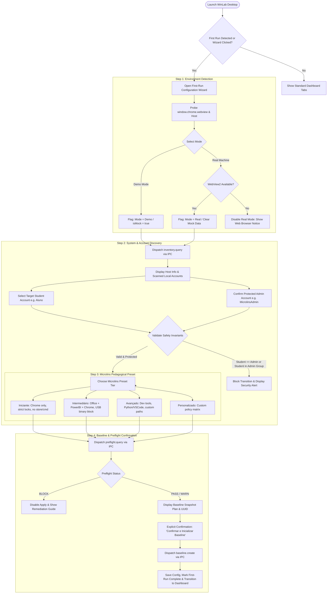

# Technical Specification & Blueprint: First-Run Configuration Wizard (Feature 14) & Real vs Demo Mode Toggle (Feature 16)

**Agent ID:** `explorer_m2_3`  
**Milestone:** Milestone 2 (Real Windows Scanner & Administrative Auth)  
**Parent Caller:** `e7faf97beb4089c3940985d95c82590f`  
**Status:** COMPLETE / SPECIFICATION READY FOR WORKER IMPLEMENTATION  
**Date:** 2026-11-10  
**Target Repository:** `/home/antigravity/krrozino/winlab`  

---

## 1. Observation

### 1.1 Current UI Architecture & Entrypoints
1. **Web Configurator Entrypoint (`src/app/page.tsx`):**
   - The web configurator at `src/app/page.tsx` provides an interactive form for generating portable PowerShell scripts (`setup.ps1`, `verify.ps1`, `rollback.ps1`) and pilot ZIP archives.
   - Presets are loaded statically from `src/lib/presets.ts` via `presets.map(...)` (lines 240–245).
   - The current preset catalog (`PresetId = "microlins" | "school" | "company" | "kiosk"`) offers a single generic `"microlins"` profile with no course-level or student-skill differentiation (no *Iniciante*, *Intermediário*, or *Avançado* pedagogical tiers).
   - Environment is inherently web-based (`window.chrome?.webview` is absent in standard browsers).

2. **Desktop Companion UI Entrypoint (`src/app/desktop/page.tsx`):**
   - Renders a multi-tab administrative interface: `"overview" | "inventory" | "presets" | "policies" | "config" | "ipc"`.
   - **Persistent Demonstration Banner Flaw (lines 203–236):** The banner `[MODO DEMONSTRAÇÃO — DADOS FICTÍCIOS / NENHUMA POLÍTICA APLICADA]` is hardcoded and rendered permanently in the DOM, irrespective of whether the application is running inside WebView2 (`isWebView2Available()`) or whether a real host is connected.
   - **Absence of Real vs Demo Mode Toggle (Feature 16 Gap):** There is no stateful toggle or mechanism allowing an administrator to switch from Demo exploration mode into Real Machine mode, or vice-versa.
   - **Absence of First-Run Configuration Wizard (Feature 14 Gap):** When launching the desktop companion, users are immediately dropped into the 6-tab complex dashboard. There is no onboarding flow to verify the host environment, discover existing Windows accounts, ensure administrative accounts remain unrestricted, select a pedagogical profile, or capture an initial baseline snapshot before applying changes.
   - **Mock Data Masquerade Vulnerability:** On mount (`useEffect` at line 104), `sendIpcMessage("inventory.query")` is called unconditionally. If running against the M1 `MockDesktopAgent`, the UI populates state with hardcoded synthetic values:
     - `computerName`: `"LAB-MICROLINS-01"`
     - Windows edition: `"Windows 11 Pro"`, version `"10.0.26100"`
     - Users: `"Administrador"` (Admin), `"AdminLocal"` (Admin), `"Aluno"` (Standard)
     - Disks: `"C:"` (237.5 GB total, 142.1 GB free)
     If a real scanner is later connected or toggled, existing React state retains these mock values unless an explicit purge and lifecycle reset is executed.

3. **IPC Bridge & Transports (`src/desktop/ipc-bridge.ts` & `src/desktop/contracts.ts`):**
   - `createDesktopTransport()` selects `WebViewIpcBridge` if `isWebView2Available()` is true, otherwise falling back to `MockDesktopAgent`.
   - `IpcConstants` defines actions: `inventory.query`, `policy.query_state`, `preflight.query`, `presets.list`, `policy.preview_diff`, `config.validate`, `policy.apply`, `policy.rollback`.
   - Notably missing from contracts:
     - IPC Action for baseline creation (`ACTION_CREATE_BASELINE = "baseline.create"`).
     - Operating mode indicators in IPC responses (`isMock: boolean`, `environment: "Browser" | "WebView2Mock" | "WebView2Real"`).
     - Account validation rules ensuring admin protection during account selection.

4. **Security & Inviolable Safety Invariants in Existing Code:**
   - In `src/lib/validation.ts` (lines 80–92), the validation engine already enforces:
     - `studentUser` and `adminUser` cannot be empty.
     - `studentUser` and `adminUser` cannot be equal (`localeCompare` check with sensitivity `accent`).
     - Windows local-user naming syntax (no `/\:;|=,*?<>@`, max 20 chars, not all spaces/dots).
   - In `tests/e2e/tier3-cross-feature.test.ts` (lines 247–304), a specification test already establishes the invariant for switching modes:
     ```typescript
     // User toggles to Real Mode
     // Mock data must be cleared when entering Real Mode
     assert.equal(realState.inventory, null);
     ```

---

## 2. Logic Chain & Architectural Specifications

### 2.1 Feature 14: First-Run Configuration Wizard Workflow & State Machine

The First-Run Configuration Wizard must guide the administrator through a safe, deterministic 4-step onboarding pipeline before any policies can be applied to the operating system.



#### Detailed Step Specifications:

#### Step 1: Environment Detection (Demo Mode vs Real Machine)
- **Goal:** Unambiguously identify whether WinLab is running inside a web browser or native desktop host, and let the operator explicitly choose between safe sandbox demonstration and real workstation setup.
- **Runtime Detection Logic:**
  ```typescript
  const isNativeDesktop = isWebView2Available(); // window.chrome?.webview?.postMessage !== undefined
  ```
- **UI Elements:**
  - **Tile A: Modo Demonstração (Sandbox Simulado)**
    - *Badge:* `AMBIENTE SEGURO (MOCK)`
    - *Description:* Execução em ambiente isolado utilizando dados fictícios (`LAB-MICROLINS-01`). Permite testar a interface, revisar políticas e simular o assistente sem qualquer impacto ou leitura no computador real.
    - *Availability:* Sempre disponível (tanto na Web quanto no Desktop).
  - **Tile B: Computador Físico / Modo Real**
    - *Badge:* `MÁQUINA LOCAL (WINDOWS)`
    - *Description:* Conecta ao host C# do Windows para escanear contas de usuário, sistema operacional, aplicativos instalados e discos reais.
    - *Availability:* Habilitado **apenas** quando `isNativeDesktop === true`. Se aberto no navegador web padrão, o botão é desabilitado com o aviso explicativo: *"Requer o aplicativo WinLab Desktop (WPF/WebView2) instalado localmente no Windows."*

#### Step 2: System & Account Discovery
- **Goal:** Enumerate local users from the host, select the student account to be restricted, and verify that administrative access cannot be accidentally locked out.
- **IPC Action:** Dispatches `IPC_CONSTANTS.ACTION_QUERY_INVENTORY` (`inventory.query`).
  - If in Real Mode: Queries live Windows inventory via Feature 11/12 scanner.
  - If in Demo Mode: Queries mock inventory (`MockDesktopAgent`).
- **Account Validation & Protection Rules (Inviolable Invariants):**
  1. **Strict Non-Equality:** `studentUser` and `adminUser` must not have the same name (case-insensitive and accent-insensitive).
  2. **Administrator Immunity Rule:** The selected `studentUser` **CANNOT** be a member of the local `Administrators` group (`user.isAdmin === false`). Attempting to target an administrator account triggers a fatal UI block:
     > *"A conta selecionada possui privilégios de Administrador. O WinLab impede restrições em contas administrativas para prevenir perda de controle do computador."*
  3. **Administrator Protection Confirmation:** The operator must verify the designated administrative account (`adminUser`) that retains full control over the machine.
  4. **Assisted Account Creation:** If the target student account (e.g., `Aluno`) does not yet exist on the machine, the UI provides an explicit toggle: `[x] Criar conta de usuário padrão 'Aluno' automaticamente durante a configuração`.

#### Step 3: Microlins Pedagogical Preset Selection
- **Goal:** Offer tailored presets matching the Microlins curriculum tiers, plus a custom option.
- **Pedagogical Tiers:**
  1. **Microlins Iniciante (Alfabetização Digital & Crianças):**
     - *Foco:* Cursos introdutórios, Informática Básica Kids, digitação e navegação inicial.
     - *Apps Permitidos:* `chrome` (apenas navegador com SafeSearch e bloqueio de extensões/modo anônimo).
     - *Bloqueios Ativos:* Bloqueio total de Prompt de Comando (CMD), PowerShell, Editor de Registro (Regedit), Microsoft Store e Instaladores (.msi/setup.exe). Bloqueio de papel de parede, ponteiros de mouse e esquemas de som.
     - *USB:* Bloqueio total de execução de binários em pendrives (`blockUsbExecute: true`).
     - *Enforcement Mode:* `AuditOnly` (fase inicial de homologação).
  2. **Microlins Intermediário (Produtividade, Office & Power BI):**
     - *Foco:* Pacote Office (Word, Excel, PowerPoint), Power BI Desktop, VLC Media Player e Google Chrome.
     - *Apps Permitidos:* `chrome`, `word`, `excel`, `powerpoint`, `powerbi`, `vlc`.
     - *Bloqueios Ativos:* CMD, PowerShell e Regedit bloqueados para o aluno. Bloqueio de instaladores. Papel de parede bloqueado com opção de desbloqueio temporário (15 minutos para atividades pedagógicas).
     - *USB:* Leitura e escrita de arquivos permitida para salvar trabalhos escolares, mas execução de binários bloqueada via AppLocker.
     - *Enforcement Mode:* `AuditOnly`.
  3. **Microlins Avançado (Design Gráfico, Web & Programação):**
     - *Foco:* Cursos técnicos de desenvolvimento web, Python, banco de dados, design ou edição de mídia.
     - *Apps Permitidos:* `chrome`, `office`, `powerbi`, `vscode`, `python`, `git` (com suporte a caminhos customizados em `customAllowedPaths`).
     - *Bloqueios:* Regedit bloqueado; CMD/PowerShell monitorados; proteção reforçada do grupo Administradores e integridade do sistema operacional.
     - *USB:* Leitura/gravação permitida; bloqueio de autorun.
     - *Enforcement Mode:* `AuditOnly`.
  4. **Personalizado (Custom):**
     - Permite ao instrutor ou administrador selecionar manualmente as políticas e aplicativos desejados ou importar um arquivo `winlab-config.json` pré-existente.

#### Step 4: Baseline Creation & Preflight Check Confirmation
- **Goal:** Execute preflight diagnostic probe, generate baseline snapshot plan, and require explicit, auditable administrative confirmation before committing initial state.
- **Preflight Verification:**
  - Dispatches `IPC_CONSTANTS.ACTION_QUERY_PREFLIGHT` (`preflight.query`).
  - Displays Readiness Score (0–100) and status badge (`PASS` / `WARN` / `BLOCK`).
  - **Gating Rule:** If any check is in `BLOCK` status (e.g., Application Identity service disabled, invalid Windows edition, insufficient disk space < 5%), the confirmation button is **disabled**, and specific remediation instructions are presented.
- **Baseline Snapshot Disclosure:**
  - Clearly discloses the snapshot plan before execution:
    - Registro do Windows: Snapshot das chaves de usuário em `C:\ProgramData\WinLab\Backups\Registry-Baseline-<timestamp>`.
    - Políticas AppLocker: Exportação do estado atual via `Get-AppLockerPolicy -Effective -Xml`.
    - Identificador de Transação: UUID v4 exclusivo registrado em `state.json`.
- **Explicit Confirmation:**
  - Checkbox: `[x] Confirmo que revisei as contas de usuário e o resumo de políticas para esta estação de trabalho.`
  - Action Button: `"Confirmar e Inicializar Baseline"` (aciona gravação de configuração e marcação de onboarding concluído).

---

### 2.2 Feature 16: Real vs Demo Mode Toggle Architecture

#### Fundamental Design Principles:
1. **Persistent Demonstration Banner:**
   - When `mode === "Demo"`, a high-visibility, non-dismissible banner is displayed at the top of the interface:
     ```
     ⚠️ [MODO DEMONSTRAÇÃO — DADOS FICTÍCIOS / NENHUMA POLÍTICA APLICADA]
     Esta instância do WinLab Desktop está operando exclusivamente em modo de simulação.
     Nenhum dado real do computador está sendo lido e nenhuma alteração será gravada.
     ```
2. **Real Mode Live Machine Indicator:**
   - When `mode === "Real"`, the Demonstration Banner is **completely removed** and replaced with an active workstation indicator:
     ```
     🟢 [MODO COMPUTADOR REAL — CONECTADO AO WINDOWS: {computerName}]
     Dados do sistema consultados ao vivo via IPC nativo. Políticas prontas para aplicação controlada.
     ```
3. **The Mock Data Purge Invariant (Zero-Masquerade Rule):**
   - **Critical Safety Law:** Under NO circumstances may mock or synthetic values (such as `"LAB-MICROLINS-01"`, dummy SIDs, or simulated app paths) remain in memory or be displayed as live machine data.
   - When toggling from Demo to Real mode:
     ```typescript
     function switchToRealMode() {
       // 1. Purge all mock data synchronously from React state
       setInventory(null);
       setPolicySummary(null);
       setPreflightData(null);
       setOperatingMode("Real");

       // 2. Dispatch real scan to live Windows host
       setIsScanning(true);
       sendIpcMessage<MachineInventoryDto>(IPC_CONSTANTS.ACTION_QUERY_INVENTORY)
         .then((res) => {
           if (res.success && res.data) {
             setInventory(res.data);
           } else {
             setScanError(res.error || "Falha ao escanear o computador real.");
           }
         })
         .finally(() => setIsScanning(false));
     }
     ```
   - If the real scan fails, times out, or returns an error, the UI displays an explicit error state (`"Falha na comunicação com o host C#"`). It **never** silently falls back to mock values.

---

### 2.3 Proposed Data Contracts & Schema Updates

#### 1. Updates to `src/lib/types.ts`:
```typescript
export type PresetId =
  | "microlins"              // Alias para compatibilidade legada
  | "microlins_iniciante"     // Alfabetização digital & Kids
  | "microlins_intermediario" // Produtividade, Office & Power BI
  | "microlins_avancado"      // Design, Web & Programação
  | "school"                 // Laboratório escolar genérico
  | "company"                // Estação corporativa compartilhada
  | "kiosk";                 // Totem de autoatendimento

export type OperatingMode = "Demo" | "Real";

export interface FirstRunState {
  isCompleted: boolean;
  completedAt?: string;
  configuredPresetId?: PresetId;
  targetStudentUser?: string;
  protectedAdminUser?: string;
  initialBaselineId?: string;
}
```

#### 2. Updates to `src/desktop/contracts.ts`:
```typescript
export const IPC_CONSTANTS = {
  PIPE_NAME: "WinLabService",
  PROTOCOL_VERSION: "1.0.0",

  ACTION_QUERY_INVENTORY: "inventory.query",
  ACTION_QUERY_POLICY_STATE: "policy.query_state",
  ACTION_QUERY_PREFLIGHT: "preflight.query",
  ACTION_LIST_PRESETS: "presets.list",
  ACTION_PREVIEW_POLICY_DIFF: "policy.preview_diff",
  ACTION_VALIDATE_CONFIG: "config.validate",

  // Novas ações para M2 (Feature 14 & 16)
  ACTION_CREATE_BASELINE: "baseline.create",
  ACTION_GET_ENVIRONMENT: "environment.detect",

  ACTION_APPLY_POLICIES: "policy.apply",
  ACTION_ROLLBACK_POLICIES: "policy.rollback"
} as const;

export interface MachineInventoryDto {
  computerName: string;
  scannedAt: string;
  isMock?: boolean; // Flag explícita indicando se os dados são simulados
  windows: WindowsInfoDto;
  detectedApps: DetectedAppDto[];
  installedApps: InstalledAppDto[];
  localUsers: LocalUserDto[];
  disks: DiskInfoDto[];
}

export interface BaselineCreationResultDto {
  transactionId: string;
  timestamp: string;
  registryBaselinePath: string;
  appLockerBaselinePath: string;
  success: boolean;
  message: string;
}
```

---

## 3. Caveats & Edge Cases

1. **Local Accounts Enumeration on Domain-Joined or Azure AD / Entra ID Workstations:**
   - Schools may have PCs joined to an Active Directory domain or Microsoft Entra ID.
   - `inventory.query` must enumerate local accounts via `Get-LocalUser` or Win32 NetUserEnum. If the current logged-in user is a domain account, WinLab must identify the local administrator account to avoid stranding recovery access.
2. **Disabled Built-in Administrator Account:**
   - On Windows 11 client editions, the built-in account named `Administrator` (`Administrador`) is disabled by default (RID 500).
   - If an administrator selects a disabled account as `adminUser`, the wizard must display a warning: *"A conta selecionada está desativada no Windows. Certifique-se de que existe uma conta administrativa ativa habilitada."*
3. **Student Account Missing at Setup Time:**
   - Often, a lab PC has only an administrator account prior to setup. If `studentUser` (e.g. `Aluno`) does not exist yet:
   - The wizard must not fail or crash. Instead, it must support the flag `createAccounts: true` and guide the administrator to generate the standard local user.
4. **Asynchronous IPC Race Condition on Mode Toggle:**
   - If the user rapidly toggles from `Demo` -> `Real` -> `Demo`:
   - A pending asynchronous `inventory.query` from Real mode could arrive after the user switched back to Demo mode.
   - Mitigation: Use a request cancellation token or generation ID (`querySequenceNumber`) to discard outdated responses.
5. **WebView2 Offline Virtual Host Boundary (`https://winlab.local`):**
   - In offline desktop mode, the wizard runs from `https://winlab.local/desktop/index.html`.
   - All state must be kept locally in React memory or synchronized via IPC to `state.json`. `localStorage` in WebView2 is sandboxed to the user's LocalAppData folder (`%LOCALAPPDATA%\WinLab\WebView2Data`).
6. **Preflight Gating vs User Frustration:**
   - Preflight `BLOCK` status must strictly inhibit baseline creation, but the UI must provide actionable, one-click copyable PowerShell remediation commands (e.g., `Start-Service AppIDSvc; Set-Service AppIDSvc -StartupType Automatic`).

---

## 4. Conclusion & Technical Implementation Blueprint

### 4.1 Component Architecture Map
```
src/
├── app/
│   ├── desktop/
│   │   ├── page.tsx                      <-- Integrated Mode Toggle & Wizard Mount
│   │   └── components/
│   │       ├── DemoBanner.tsx            <-- Persistent Demo Banner vs Real Machine Badge
│   │       ├── ModeToggle.tsx            <-- Segmented Toggle Button (Demo vs Real)
│   │       └── wizard/
│   │           ├── FirstRunWizard.tsx    <-- 4-Step Wizard Container
│   │           ├── Step1Environment.tsx  <-- Demo vs Real Machine Detection
│   │           ├── Step2Accounts.tsx     <-- User & Admin Discovery & Invariant Checks
│   │           ├── Step3Presets.tsx      <-- Microlins Tiers (Iniciante, Intermediário, Avançado)
│   │           └── Step4Baseline.tsx     <-- Preflight & Baseline Confirmation
├── lib/
│   ├── types.ts                          <-- Extended PresetId & OperatingMode types
│   ├── presets.ts                        <-- Added Microlins tiered preset configurations
│   └── validation.ts                     <-- Reusable account safety checks
└── desktop/
    ├── contracts.ts                      <-- Updated DTOs & Action constants
    ├── mock-agent.ts                     <-- Mock handlers for baseline & tiered presets
    └── ipc-bridge.ts                     <-- Environment detection & safe purge helpers
```

### 4.2 Exact Implementation Prototypes

#### Prototype 1: Microlins Pedagogical Presets (`src/lib/presets.ts`)
```typescript
export const presets: Preset[] = [
  {
    id: "microlins_iniciante",
    name: "Microlins — Iniciante (Kids & Alfabetização)",
    description: "Ambiente estritamente protegido para cursos introdutórios. Apenas Chrome liberado, com bloqueio total de personalização, Store e utilitários do sistema.",
    config: {
      ...defaultConfig,
      profileName: "Microlins Iniciante",
      studentUser: "Aluno",
      adminUser: "MicrolinsAdmin",
      allowedApps: ["chrome"],
      blockInstallers: true,
      blockStoreApps: true,
      blockCmd: true,
      blockPowerShell: true,
      blockRegedit: true,
      blockWallpaper: true,
      blockMousePointers: true,
      blockSoundScheme: true,
      blockUsbExecute: true,
      blockChromeExtensions: true,
      blockChromeGuest: true,
      blockChromeIncognito: true,
      browserUrlMode: "BlockList",
      enforcementMode: "AuditOnly"
    }
  },
  {
    id: "microlins_intermediario",
    name: "Microlins — Intermediário (Office & Power BI)",
    description: "Perfil padrão para laboratórios de informática comercial. Chrome, Office 365, Power BI e VLC liberados com bloqueio de pendrives executáveis.",
    config: {
      ...defaultConfig,
      profileName: "Microlins Intermediário",
      studentUser: "Aluno",
      adminUser: "MicrolinsAdmin",
      allowedApps: ["chrome", "word", "excel", "powerpoint", "powerbi", "vlc"],
      blockInstallers: true,
      blockStoreApps: true,
      blockCmd: true,
      blockPowerShell: true,
      blockRegedit: true,
      blockWallpaper: true,
      wallpaperUnlockMinutes: 15,
      blockUsbExecute: true,
      blockChromeExtensions: true,
      blockChromePasswordManager: true,
      enforcementMode: "AuditOnly"
    }
  },
  {
    id: "microlins_avancado",
    name: "Microlins — Avançado (Design & Programação)",
    description: "Perfil flexível para cursos de desenvolvimento, design e tecnologias avançadas. Suporte a caminhos customizados com salvaguardas no sistema.",
    config: {
      ...defaultConfig,
      profileName: "Microlins Avançado",
      studentUser: "Aluno",
      adminUser: "MicrolinsAdmin",
      allowedApps: ["chrome", "word", "excel", "powerpoint", "powerbi", "vlc"],
      blockInstallers: false,
      blockStoreApps: false,
      blockCmd: false,
      blockPowerShell: false,
      blockRegedit: true,
      blockWallpaper: false,
      blockUsbExecute: true,
      enforcementMode: "AuditOnly"
    }
  },
  // Preservado para compatibilidade retroativa
  {
    id: "microlins",
    name: "Microlins (Padrão)",
    description: "Laboratório com Chrome, Office, Power BI e personalização controlada.",
    config: {
      ...defaultConfig,
      profileName: "Microlins Lab",
      studentUser: "Aluno",
      adminUser: "MicrolinsAdmin",
      enforcementMode: "AuditOnly"
    }
  },
  // Presets school, company e kiosk mantidos integralmente...
];
```

#### Prototype 2: Demo Banner vs Real Machine Indicator (`src/app/desktop/components/DemoBanner.tsx`)
```tsx
interface DemoBannerProps {
  mode: "Demo" | "Real";
  computerName?: string;
  isWebView2Available: boolean;
}

export function DemoBanner({ mode, computerName, isWebView2Available }: DemoBannerProps) {
  if (mode === "Demo") {
    return (
      <div
        role="alert"
        aria-label="Demonstration Mode"
        style={{
          background: "rgba(255, 122, 24, 0.12)",
          border: "2px solid var(--accent)",
          borderRadius: 10,
          padding: "12px 16px",
          marginBottom: 20,
          display: "flex",
          alignItems: "center",
          gap: 12
        }}
      >
        <span style={{ fontSize: 22 }}>⚠️</span>
        <div style={{ flex: 1 }}>
          <strong
            style={{
              color: "var(--accent)",
              fontSize: 13,
              letterSpacing: "0.04em",
              display: "block",
              textTransform: "uppercase"
            }}
          >
            [MODO DEMONSTRAÇÃO — DADOS FICTÍCIOS / NENHUMA POLÍTICA APLICADA]
          </strong>
          <span style={{ color: "var(--muted)", fontSize: 12, display: "block", marginTop: 2 }}>
            Esta instância do WinLab Desktop está operando exclusivamente em modo de simulação e fundação.
            Nenhuma política, serviço privilegiado ou alteração de registro será gravada neste computador.
          </span>
        </div>
      </div>
    );
  }

  return (
    <div
      role="status"
      aria-label="Real Computer Mode"
      style={{
        background: "rgba(46, 204, 113, 0.12)",
        border: "2px solid var(--success)",
        borderRadius: 10,
        padding: "12px 16px",
        marginBottom: 20,
        display: "flex",
        alignItems: "center",
        gap: 12
      }}
    >
      <span style={{ fontSize: 20 }}>🟢</span>
      <div style={{ flex: 1 }}>
        <strong
          style={{
            color: "var(--success)",
            fontSize: 13,
            letterSpacing: "0.04em",
            display: "block",
            textTransform: "uppercase"
          }}
        >
          [MODO COMPUTADOR REAL — CONECTADO AO WINDOWS: {computerName ?? "LOCAL"}]
        </strong>
        <span style={{ color: "var(--muted)", fontSize: 12, display: "block", marginTop: 2 }}>
          Dados de hardware, contas locais e aplicativos obtidos diretamente do sistema operacional via IPC nativo.
        </span>
      </div>
    </div>
  );
}
```

---

## 5. Verification Method

### 5.1 Automated TypeScript Test Suite (`tsx --test`)
Add dedicated test coverage in `tests/wizard-and-mode.test.ts` verifying:
1. **Mode Toggle Invariant:** Switching from `Demo` to `Real` mode:
   - Sets `mode = "Real"`.
   - Clears `inventory`, `policySummary`, and `preflightData` to `null`.
   - Verifies zero mock values remain.
2. **Account Security Invariants:**
   - Rejects `studentUser === adminUser`.
   - Rejects selecting an account with `isAdmin === true` as the `studentUser`.
   - Validates user naming character limits and illegal symbols.
3. **Preset Compatibility:**
   - Ensures `getPreset("microlins_iniciante")`, `getPreset("microlins_intermediario")`, and `getPreset("microlins_avancado")` return structurally valid configurations conforming to schema version 1.
4. **Preflight Gating:**
   - Confirms baseline application is blocked when preflight report contains `status: "BLOCK"`.

### 5.2 Automated C# xUnit Test Suite (`WinLab.Tests`)
Execute via `.dotnet/dotnet test desktop/tests/WinLab.Tests/WinLab.Tests.csproj -c Release`:
1. Verify `IpcConstants` includes `ActionCreateBaseline` and `ActionGetEnvironment`.
2. Verify `MockAgentService` handles `baseline.create` without modifying the system.
3. Verify that `SecurityValidator` enforces strict envelope validation for all new actions.

### 5.3 Manual QA & Verification Checklist for Worker/Auditor
- [ ] **Scenario A (Web Browser / Static Mode):** Open `http://localhost:3000/desktop`. Verify Demo Banner is visible, and the "Computador Real" toggle option is safely disabled.
- [ ] **Scenario B (First-Run Wizard Walkthrough):**
  - Step 1: Select Demo Mode or Real Machine.
  - Step 2: Verify user list shows administrator with shield icon. Try to select Administrator as student; confirm immediate safety block.
  - Step 3: Select "Microlins — Intermediário". Verify apps list reflects Office + Power BI.
  - Step 4: Verify preflight report score. Click "Confirmar e Inicializar Baseline".
- [ ] **Scenario C (Mode Switching):** In desktop mode, toggle between Demo and Real mode. Observe that mock data is purged completely before live scan results populate the screen.
- [ ] **Scenario D (Static Export Build):** Execute `npm run build:desktop` and verify offline export succeeds with 0 errors.

---
*Report prepared by `explorer_m2_3`. Ready for Worker implementation.*
