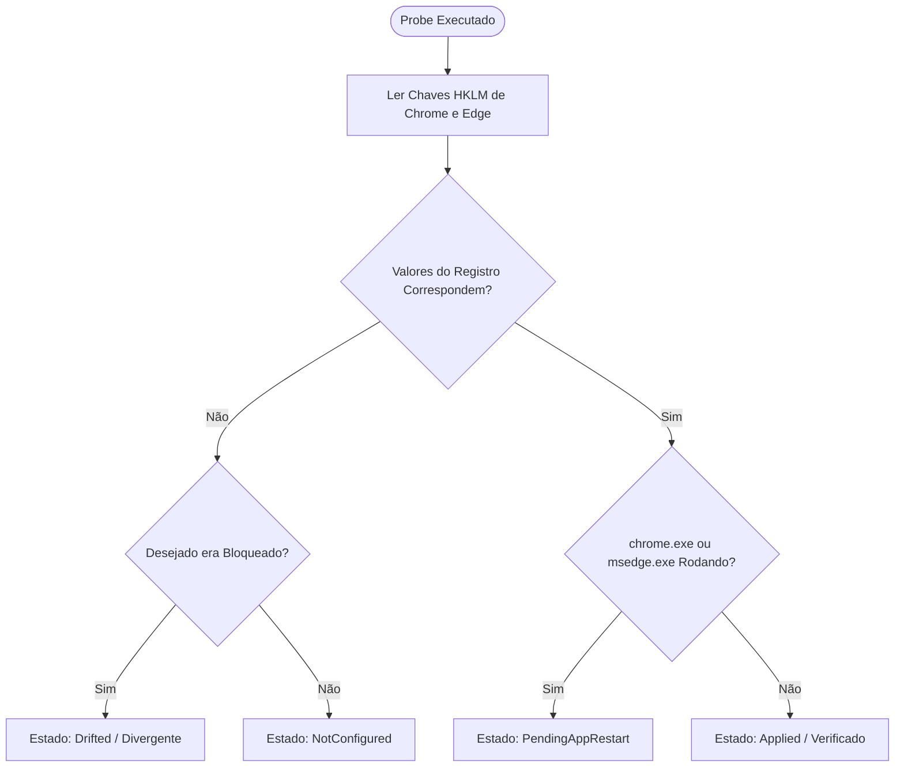

# Especificação Técnica e Blueprint de Implementação — Milestone 3
## Features 17 (Declarative Policy Catalog), 21 (Chrome Incognito Lock) e 22 (Chrome Guest Lock)
**WinLab Desktop — First Functional Policy Engine**

- **Data:** 10 de novembro de 2026
- **Autor:** Technical Explorer 2 (`explorer_m3_2`)
- **Destinatário:** Project Orchestrator (`12bf6eae78a7fe11007f4aea28270901`)
- **Escopo:**
  1. Especificação detalhada do Registro do Windows para **Feature 21** (Chrome Incognito Lock & Edge InPrivate Lock) e **Feature 22** (Chrome Guest Mode Lock & Edge Guest Mode Lock).
  2. Arquitetura e Contratos do **Feature 17** (Declarative Policy Catalog) abrangendo o catálogo inicial de 5 políticas do Milestone 3 (Wallpaper, Sounds, Mouse Pointers, Chrome Incognito, Chrome Guest).
  3. Design e especificação de **Probes de Verificação Read-Only** para políticas de navegadores, com suporte a Tri-State (`Desired` vs `Configured` vs `Effective`) e detecção de processos em execução.
  4. Blueprint concreto de implementação para o Worker (TypeScript e C# .NET 10 LTS), com suporte a testes unitários determinísticos em Linux e Windows.

---

## 1. Executive Summary & Context

O **Milestone 3 (M3)** marca a transição definitiva do WinLab Desktop de uma fundação puramente de leitura/mock para um **Policy Engine funcional de verdade**. 

Conforme estabelecido nas seções 4, 5, 6, 7 e 15 do `ORIGINAL_REQUEST.md`:
> *"O WinLab Desktop precisa deixar de depender somente do Mock Agent... Escolher de três a cinco políticas de baixo risco e realmente reversíveis. Implementar fluxo completo: Detectar -> Preview -> Autorizar -> Backup -> Aplicar -> Verificar -> Persistir -> Reverter. Não mostrar 'Ativado' simplesmente porque um comando terminou sem erro."*

Este relatório consolida a investigação técnica e o blueprint arquitetural para:
1. **Feature 17 (Declarative Policy Catalog):** Substituição de códigos imperativos e scripts monolíticos por um catálogo declarativo fortemente tipado, compartilhado entre TypeScript (`src/lib/policies.ts`) e C# (`desktop/src/WinLab.Contracts/PolicyCatalog.cs`).
2. **Feature 21 (Chrome Incognito Lock):** Bloqueio estrito de navegação anônima no Google Chrome (`IncognitoModeAvailability` = 1) e no Microsoft Edge (`InPrivateModeAvailability` = 1).
3. **Feature 22 (Chrome Guest Mode Lock):** Bloqueio estrito do perfil de visitante/convidado no Google Chrome (`BrowserGuestModeEnabled` = 0) e no Microsoft Edge (`BrowserGuestModeEnabled` = 0).
4. **Probes de Verificação Não-Intrusivos:** Mecanismo de leitura defensiva do registro e inspeção de processos em execução para calcular o estado efetivo (`EffectiveState`) sem gerar popups visuais, sem abrir janelas de navegadores e sem executar shells (`powershell.exe` / `cmd.exe`).

---

## 2. Investigação Técnica Aprofundada do Registro do Windows (Features 21 e 22)

### 2.1 Feature 21: Chrome Incognito Lock & Edge InPrivate Lock

#### 2.1.1 Google Chrome (`IncognitoModeAvailability`)
- **Especificação Oficial da Google Enterprise Policy:**
  - **Identificador de Política:** `IncognitoModeAvailability`
  - **Hive Preferencial no WinLab:** `HKEY_LOCAL_MACHINE` (Escopo de Máquina / Dispositivo)
  - **Caminho do Registro:** `SOFTWARE\Policies\Google\Chrome`
  - **Caminho Completo:** `HKLM\SOFTWARE\Policies\Google\Chrome`
  - **Caminho de Fallback/Usuário:** `HKCU\SOFTWARE\Policies\Google\Chrome` (ou `HKU\<SID>\SOFTWARE\Policies\Google\Chrome`)
  - **Tipo de Dados:** `REG_DWORD` (DWORD de 32 bits)
  - **Semântica dos Valores:**
    - `0` (ou valor ausente): **Disponível** (`IncognitoModeAvailable`). O usuário pode alternar livremente entre janelas normais e anônimas através do menu, atalho `Ctrl+Shift+N` ou parâmetro `--incognito`.
    - `1`: **Desabilitado** (`IncognitoModeDisabled`). O modo anônimo é completamente desativado. A opção "Nova janela anônima" fica esmaecida/oculta no menu principal, o atalho `Ctrl+Shift+N` não tem efeito e o argumento `--incognito` na linha de comando abre uma janela normal do perfil ativo.
    - `2`: **Forçado** (`IncognitoModeForced`). Todas as janelas abrem exclusivamente em modo anônimo (inadequado para laboratórios com autenticação e histórico).
  - **Valor Alvo WinLab (Bloqueado):** `1` (`DWORD 0x00000001`).
  - **Valor Padrão / Reversão (Desbloqueado):** Remoção do valor `IncognitoModeAvailability` ou gravação de `0`.

#### 2.1.2 Microsoft Edge (`InPrivateModeAvailability`)
- **Especificação Oficial da Microsoft Edge Enterprise Policy:**
  - **Identificador de Política:** `InPrivateModeAvailability` (Atenção: A Microsoft utiliza `InPrivate` em vez de `Incognito`).
  - **Hive Preferencial:** `HKEY_LOCAL_MACHINE`
  - **Caminho do Registro:** `SOFTWARE\Policies\Microsoft\Edge`
  - **Caminho Completo:** `HKLM\SOFTWARE\Policies\Microsoft\Edge`
  - **Tipo de Dados:** `REG_DWORD`
  - **Semântica dos Valores:**
    - `0` (ou ausente): **Disponível** (`InPrivateModeAvailable`).
    - `1`: **Desabilitado** (`InPrivateModeDisabled`). A opção "Nova janela InPrivate" é ocultada e o atalho `Ctrl+Shift+N` é bloqueado.
    - `2`: **Forçado** (`InPrivateModeForced`).
  - **Valor Alvo WinLab (Bloqueado):** `1` (`DWORD 0x00000001`).
  - **Valor Padrão / Reversão:** Remoção do valor `InPrivateModeAvailability` ou gravação de `0`.

---

### 2.2 Feature 22: Chrome Guest Mode Lock & Edge Guest Mode Lock

#### 2.2.1 Google Chrome (`BrowserGuestModeEnabled`)
- **Especificação Oficial:**
  - **Identificador de Política:** `BrowserGuestModeEnabled`
  - **Hive Preferencial:** `HKEY_LOCAL_MACHINE`
  - **Caminho do Registro:** `SOFTWARE\Policies\Google\Chrome`
  - **Tipo de Dados:** `REG_DWORD`
  - **Semântica dos Valores:**
    - `1` (ou ausente): **Habilitado**. O usuário pode clicar no avatar do perfil e selecionar "Abrir janela como convidado" ou iniciar via `--guest`.
    - `0`: **Desabilitado**. O modo convidado é completamente desativado. O seletor de perfil oculta a opção de convidado, e chamadas CLI com `--guest` são descartadas.
  - **Valor Alvo WinLab (Bloqueado):** `0` (`DWORD 0x00000000`).
  - **Valor Padrão / Reversão:** Remoção da propriedade ou gravação de `1`.

#### 2.2.2 Microsoft Edge (`BrowserGuestModeEnabled`)
- **Especificação Oficial:**
  - **Identificador de Política:** `BrowserGuestModeEnabled`
  - **Hive Preferencial:** `HKEY_LOCAL_MACHINE`
  - **Caminho do Registro:** `SOFTWARE\Policies\Microsoft\Edge`
  - **Tipo de Dados:** `REG_DWORD`
  - **Semântica dos Valores:**
    - `1` (ou ausente): Habilitado.
    - `0`: Desabilitado.
  - **Valor Alvo WinLab (Bloqueado):** `0` (`DWORD 0x00000000`).
  - **Valor Padrão / Reversão:** Remoção da propriedade ou gravação de `1`.

---

### 2.3 Árvore do Registro, Criação de Chaves e Segurança de Permissões

#### 2.3.1 Criação Defensiva da Árvore de Subchaves
Em instalações limpas do Windows 10/11, as subchaves de políticas de fornecedores de software frequentemente **não existem**. Por exemplo:
- `HKLM\SOFTWARE\Policies` existe por padrão no Windows.
- `HKLM\SOFTWARE\Policies\Google` geralmente **NÃO** existe até que o Google Chrome seja gerenciado pela primeira vez.
- `HKLM\SOFTWARE\Policies\Google\Chrome` precisa ser criada recursivamente.
- `HKLM\SOFTWARE\Policies\Microsoft\Edge` frequentemente precisa ser criada sob a chave `Microsoft`.

O executor de mutação deve criar as subchaves intermediárias de forma segura:
```csharp
using var baseKey = RegistryKey.OpenBaseKey(RegistryHive.LocalMachine, RegistryView.Default);
using var chromeKey = baseKey.CreateSubKey(@"SOFTWARE\Policies\Google\Chrome", true);
chromeKey.SetValue("IncognitoModeAvailability", 1, RegistryValueKind.DWord);
chromeKey.SetValue("BrowserGuestModeEnabled", 0, RegistryValueKind.DWord);
```

#### 2.3.2 Permissões e Modelo de Ameaça (ACLs)
- **Permissões em `HKLM\SOFTWARE\Policies`:**
  - `BUILTIN\Administrators` e `NT AUTHORITY\SYSTEM`: **Full Control** (`KEY_ALL_ACCESS`).
  - `BUILTIN\Users` (`S-1-5-32-545`, grupo que inclui o aluno / usuário padrão): Apenas **Read** (`KEY_READ` = `KEY_QUERY_VALUE | KEY_ENUMERATE_SUB_KEYS | KEY_NOTIFY`).
- **Implicações de Segurança Fundamentais:**
  1. **Privilégio na Escrita:** Processos não elevados (como a interface `WinLab.Desktop` em `asInvoker`) receberão `SecurityException` ou `UnauthorizedAccessException` se tentarem gravar em `HKLM`. Portanto, **a aplicação e o rollback devem ser despachados para o helper elevado `WinLab.Executor` via UAC**.
  2. **Inviolabilidade pelo Aluno:** Como o aluno não possui permissão de escrita em `HKLM`, o aluno **não consegue desativar a política** via `regedit`, linha de comando, arquivo `.bat` ou ferramentas de usuário.
  3. **Segurança de Leitura (`asInvoker`):** Usuários comuns têm permissão nativa para consultar valores em `HKLM\SOFTWARE\Policies`. Isso significa que **os Probes de Verificação podem ser executados pelo Desktop sem pedir elevação UAC**, permitindo monitoramento de drift contínuo e rápido!
  4. **Precedência de Políticas no Chromium:** Quando uma política corporativa está configurada em `HKLM`, o Chromium a prioriza acima de qualquer configuração em `HKCU` ou configurações locais do usuário. Mesmo que o aluno tente criar chaves em `HKCU`, a diretiva de máquina (`HKLM`) prevalece inviolável.

---

### 2.4 Ciclo de Vida da Aplicação e Comportamento dos Navegadores

| Dimensão | Comportamento Observado no Chromium (Chrome e Edge) |
|---|---|
| **Requer Reinicialização do Windows (`RequiresRestart`)?** | **NÃO.** O kernel e o subsistema Win32 não dependem de reboot para políticas de navegador. |
| **Requer Logoff do Usuário (`RequiresLogoff`)?** | **NÃO.** A sessão do Windows não precisa ser encerrada. |
| **Requer Reinício do Navegador (`RequiresAppRestart`)?** | **SIM.** Processos do Chrome/Edge já abertos em memória mantêm em cache o dicionário de políticas carregado na inicialização. |
| **Detecção de Processo Ativo:** | Se `chrome.exe` ou `msedge.exe` estiverem em execução no momento da gravação do registro, as janelas abertas anteriormente continuam em execução até o navegador ser fechado e reaberto, ou até a recarga em `chrome://policy`. |
| **Mapeamento de Estado Efetivo:** | Se o registro estiver gravado com sucesso (`ConfiguredState == Blocked`), mas existirem instâncias de `chrome.exe` ou `msedge.exe` em execução, o estado efetivo é reportado como **`PendingAppRestart`** em vez de `Applied`. Assim que o usuário reinicia o navegador (ou caso não haja processos abertos), o estado transita para **`Applied`**. |

---

## 3. Design da Feature 17: Declarative Policy Catalog

### 3.1 Arquitetura e Racional de Design

Atualmente, o WinLab possui:
- O tipo `Config` com booleanos planos (`blockChromeIncognito`, `blockChromeGuest`, `blockWallpaper`, etc.) em `src/lib/types.ts`.
- Geração imperativa de scripts em `src/lib/generator.ts`.
- Um mock estático em `src/desktop/mock-agent.ts` e `WinLab.Agent.Mock/MockAgentService.cs`.

A **Feature 17** estabelece um **Catálogo Declarativo Centralizado**. Cada política é um objeto autônomo com identificador canônico, metadados semânticos, descritores de probe de leitura, requisitos de ativação e regras de mutação/reversão.

```
┌────────────────────────────────────────────────────────────────────────┐
│                   DECLARATIVE POLICY CATALOG                           │
│                                                                        │
│  ┌──────────────────────────────────────────────────────────────────┐  │
│  │ PolicyDefinition                                                 │  │
│  │ • Id: "browser.chrome.incognito"                                 │  │
│  │ • Category: "Navegadores"                                        │  │
│  │ • RiskLevel: Low                                                 │  │
│  │ • Scope: Machine                                                 │  │
│  │ • Reversible: true                                               │  │
│  │ • Activation: { RequiresRestart: false, RequiresLogoff: false,    │  │
│  │                 RequiresAppRestart: true }                       │  │
│  │ • Probes: [ ChromeRegistryProbe, EdgeRegistryProbe ]             │  │
│  │ • Mutators: RegistryDwordSetter(1) / RegistryDwordCleaner()      │  │
│  └──────────────────────────────────────────────────────────────────┘  │
└────────────────────────────────────────────────────────────────────────┘
                                   │
         Shared Schemas across TypeScript & C# .NET 10 LTS
                                   ▼
┌─────────────────────────────────┐    ┌─────────────────────────────────┐
│ TypeScript Catalog              │    │ C# Contracts & Catalog          │
│ • src/lib/policies.ts           │    │ • WinLab.Contracts/Policy...cs  │
│ • src/desktop/contracts.ts      │    │ • WinLab.Contracts/PolicyCat... │
│ • Validated by schema & vitest  │    │ • Validated by WinLab.Tests     │
└─────────────────────────────────┘    └─────────────────────────────────┘
```

---

### 3.2 Metadados e Esquema das Políticas

Cada política no catálogo possui os seguintes campos rigorosamente padronizados:

| Campo | Tipo | Descrição |
|---|---|---|
| `Id` | `string` | Identificador único canônico no formato `{categoria}.{recurso}` (ex: `"browser.chrome.incognito"`). |
| `Name` | `string` | Nome amigável legível (ex: `"Bloquear Navegação Anônima (Chrome e Edge)"`). |
| `Category` | `string` | Categoria visual (`"Navegadores"`, `"Personalização"`, `"Sistema"`, `"Contas"`). |
| `Description` | `string` | Explicação clara do efeito técnico e impacto para alunos e professores. |
| `RiskLevel` | `PolicyRisk` | Nível de risco (`Low`, `Medium`, `High`, `Critical`). As 5 políticas do M3 são todas `Low`. |
| `Scope` | `PolicyScope` | Escopo operacional: `Machine` (afeta todos os usuários do PC via HKLM) ou `User` (afeta HKCU/HKU). |
| `Reversible` | `bool` | Se a política pode ser revertida de forma limpa e segura (`true` para todas as 5). |
| `RequiresRestart` | `bool` | Se exige reboot do Windows (`false` para as 5 políticas do M3). |
| `RequiresLogoff` | `bool` | Se exige logoff da sessão do usuário (`true` apenas para Wallpaper). |
| `RequiresAppRestart` | `bool` | Se exige fechamento/reabertura do aplicativo (`true` para Chrome e Edge). |
| `ProbeStrategy` | `PolicyProbeDescriptor` | Estratégia de leitura: hive, subkey, valueName, tipo de dados e valor esperado. |

---

### 3.3 As 5 Políticas Iniciais do Milestone 3

```
┌────────────────────────────────────────────────────────────────────────┐
│               MILESTONE 3: AS 5 POLÍTICAS HOMOLOGADAS                   │
├──────────────────────────────┬─────────┬─────────┬──────────┬──────────┤
│ Política                     │ Escopo  │ Risco   │ Logoff?  │ AppRest? │
├──────────────────────────────┼─────────┼─────────┼──────────┼──────────┤
│ 1. personalization.wallpaper │ User    │ Low     │ SIM      │ Não      │
│ 2. personalization.sounds    │ User    │ Low     │ Não      │ Não      │
│ 3. personalization.mouse_ptrs│ User    │ Low     │ Não      │ Não      │
│ 4. browser.chrome.incognito  │ Machine │ Low     │ Não      │ SIM      │
│ 5. browser.chrome.guest      │ Machine │ Low     │ Não      │ SIM      │
└──────────────────────────────┴─────────┴─────────┴──────────┴──────────┘
```

#### Detalhamento Técnico das 5 Políticas:

1. **`personalization.wallpaper` — Bloqueio de Papel de Parede**
   - **ID:** `personalization.wallpaper`
   - **Nome:** Bloquear Alteração de Papel de Parede
   - **Categoria:** Personalização
   - **Risco:** `Low` | **Escopo:** `User`
   - **Reversível:** `true` | **Logoff:** `true` | **Reboot:** `false` | **AppRestart:** `false`
   - **Alvo Registro:** `HKCU\Software\Microsoft\Windows\CurrentVersion\Policies\ActiveDesktop`
   - **Valor:** `NoChangingWallPaper` (`REG_DWORD = 1`)
   - **Probe:** Verifica existência de `NoChangingWallPaper == 1` na hive do usuário.

2. **`personalization.sounds` — Bloqueio de Sons do Sistema**
   - **ID:** `personalization.sounds`
   - **Nome:** Bloquear Esquema de Sons
   - **Categoria:** Personalização
   - **Risco:** `Low` | **Escopo:** `User`
   - **Reversível:** `true` | **Logoff:** `false` | **Reboot:** `false` | **AppRestart:** `false`
   - **Alvo Registro:** `HKCU\Software\Policies\Microsoft\Windows\Personalization`
   - **Valor:** `NoChangingSoundScheme` (`REG_DWORD = 1`)
   - **Probe:** Verifica `NoChangingSoundScheme == 1`.

3. **`personalization.mouse_pointers` — Bloqueio de Ponteiros do Mouse**
   - **ID:** `personalization.mouse_pointers`
   - **Nome:** Bloquear Alteração de Ponteiros do Mouse
   - **Categoria:** Personalização
   - **Risco:** `Low` | **Escopo:** `User`
   - **Reversível:** `true` | **Logoff:** `false` | **Reboot:** `false` | **AppRestart:** `false`
   - **Alvo Registro:** `HKCU\Software\Policies\Microsoft\Windows\Personalization`
   - **Valor:** `NoChangingMousePointers` (`REG_DWORD = 1`)
   - **Probe:** Verifica `NoChangingMousePointers == 1`.

4. **`browser.chrome.incognito` — Bloqueio de Modo Anônimo (Chrome + Edge)**
   - **ID:** `browser.chrome.incognito`
   - **Nome:** Bloquear Navegação Anônima (Chrome e Edge)
   - **Categoria:** Navegadores
   - **Risco:** `Low` | **Escopo:** `Machine`
   - **Reversível:** `true` | **Logoff:** `false` | **Reboot:** `false` | **AppRestart:** `true`
   - **Alvos de Registro:**
     - Chrome: `HKLM\SOFTWARE\Policies\Google\Chrome\IncognitoModeAvailability` (`REG_DWORD = 1`)
     - Edge: `HKLM\SOFTWARE\Policies\Microsoft\Edge\InPrivateModeAvailability` (`REG_DWORD = 1`)
   - **Probe:** Valida ambos os valores DWORD no registro e checa se `chrome.exe` ou `msedge.exe` estão em execução.

5. **`browser.chrome.guest` — Bloqueio de Modo Convidado (Chrome + Edge)**
   - **ID:** `browser.chrome.guest`
   - **Nome:** Bloquear Modo Convidado (Chrome e Edge)
   - **Categoria:** Navegadores
   - **Risco:** `Low` | **Escopo:** `Machine`
   - **Reversível:** `true` | **Logoff:** `false` | **Reboot:** `false` | **AppRestart:** `true`
   - **Alvos de Registro:**
     - Chrome: `HKLM\SOFTWARE\Policies\Google\Chrome\BrowserGuestModeEnabled` (`REG_DWORD = 0`)
     - Edge: `HKLM\SOFTWARE\Policies\Microsoft\Edge\BrowserGuestModeEnabled` (`REG_DWORD = 0`)
   - **Probe:** Valida se ambos os valores DWORD são `0` e checa status dos processos de navegadores.

---

## 4. Design dos Probes de Verificação Read-Only para Navegadores

### 4.1 O Modelo Tri-State na Prática

O WinLab rejeita categoricamente declarar sucesso apenas porque um comando não lançou exceção. Para cada política, três estados são avaliados:
1. **Desired State (`Estado Desejado`):** Definido pelo administrador na configuração (`NotConfigured`, `Allowed`, `Blocked`).
2. **Configured State (`Estado Configurado`):** O que está gravado na persistência (`C:\ProgramData\WinLab\state.json`) e gravado no registro do Windows.
3. **Effective State (`Estado Efetivo / Verificado`):** O que foi apurado pelo Probe dinâmico em tempo real.



### 4.2 Lógica do Probe Read-Only (C#)

O probe:
1. Abre as chaves em modo somente-leitura (`writable: false`).
2. Trata ausência de chaves (`null`) defensivamente sem lançar exceções.
3. Checa a presença de processos ativos via `Process.GetProcessesByName("chrome")` e `Process.GetProcessesByName("msedge")`.
4. Produz evidências em texto legível para auditoria.

```csharp
public class BrowserPolicyProbe
{
    public static PolicyProbeResult EvaluateIncognitoLock(IRegistryAccessor registry, IProcessAccessor processAccessor)
    {
        // 1. Inspecionar Chrome
        int? chromeVal = registry.GetDWord(
            RegistryHive.LocalMachine, 
            @"SOFTWARE\Policies\Google\Chrome", 
            "IncognitoModeAvailability");

        // 2. Inspecionar Edge
        int? edgeVal = registry.GetDWord(
            RegistryHive.LocalMachine, 
            @"SOFTWARE\Policies\Microsoft\Edge", 
            "InPrivateModeAvailability");

        bool chromeConfigured = (chromeVal == 1);
        bool edgeConfigured = (edgeVal == 1);

        if (!chromeConfigured && !edgeConfigured)
        {
            return new PolicyProbeResult
            {
                ConfiguredState = PolicyState.NotConfigured,
                EffectiveState = EffectiveState.NotConfigured,
                Evidence = $"Chrome: {(chromeVal.HasValue ? chromeVal.Value.ToString() : "Ausente")}, Edge: {(edgeVal.HasValue ? edgeVal.Value.ToString() : "Ausente")}"
            };
        }

        bool isFullyConfigured = chromeConfigured && edgeConfigured;
        var configuredState = isFullyConfigured ? PolicyState.Blocked : PolicyState.NotConfigured;

        // 3. Checar processos ativos para determinar EffectiveState
        bool isChromeRunning = processAccessor.IsProcessRunning("chrome");
        bool isEdgeRunning = processAccessor.IsProcessRunning("msedge");

        EffectiveState effective;
        if (isFullyConfigured)
        {
            if (isChromeRunning || isEdgeRunning)
            {
                effective = EffectiveState.PendingAppRestart;
            }
            else
            {
                effective = EffectiveState.Applied;
            }
        }
        else
        {
            effective = EffectiveState.Drifted; // Configuração parcial ou divergente
        }

        return new PolicyProbeResult
        {
            ConfiguredState = configuredState,
            EffectiveState = effective,
            Evidence = $"Chrome Incognito: {chromeVal}, Edge InPrivate: {edgeVal}, Chrome Ativo: {isChromeRunning}, Edge Ativo: {isEdgeRunning}"
        };
    }
}
```

---

## 5. Blueprint Concreto de Implementação

### 5.1 Novos Arquivos e Estrutura de Código

```
winlab/
├── src/
│   ├── lib/
│   │   └── policies.ts                        # [NOVO] Catálogo Declarativo em TypeScript
│   └── desktop/
│       ├── contracts.ts                       # [ATUALIZADO] DTOs enriquecidos e enums
│       └── mock-agent.ts                      # [ATUALIZADO] Retorna catálogo oficial das 5 políticas
├── desktop/
│   ├── src/
│   │   ├── WinLab.Contracts/
│   │   │   ├── PolicyModels.cs                # [ATUALIZADO] Enums, DTOs e descritores de probes
│   │   │   ├── PolicyCatalog.cs               # [NOVO] Catálogo estático C# das 5 políticas
│   │   │   └── Probing/                       # [NOVO] Sistema de Probes Read-Only
│   │   │       ├── IRegistryAccessor.cs       # Interface mockável para Linux/Windows
│   │   │       ├── IProcessAccessor.cs        # Interface mockável de processos
│   │   │       ├── SystemRegistryAccessor.cs  # Implementação Windows via RegistryKey
│   │   │       └── PolicyProbeService.cs      # Avaliador central de probes
│   │   ├── WinLab.Executor/
│   │   │   └── ExecutorHost.cs                # [ATUALIZADO] Despacha policy.query_state com probes reais
│   │   └── WinLab.Desktop/
│   │       └── Services/
│   │           └── RealAgentService.cs        # [ATUALIZADO] Despacha queries para Executor/Scanner
│   └── tests/
│       └── WinLab.Tests/
│           ├── PolicyCatalogTests.cs          # [NOVO] Testes do catálogo e integridade
│           └── PolicyProbeTests.cs            # [NOVO] Testes dos probes em Linux com mock
```

---

### 5.2 TypeScript Catalog Blueprint (`src/lib/policies.ts`)

```typescript
/**
 * WinLab Desktop — Catálogo Declarativo de Políticas (Feature 17)
 * Define metadados, escopo, nível de risco, requisitos de logoff/reboot e estratégias de probe.
 */

export type PolicyRiskLevel = "Low" | "Medium" | "High" | "Critical";
export type PolicyScope = "Machine" | "User";
export type PolicyState = "NotConfigured" | "Allowed" | "Blocked";

export type EffectivePolicyState =
  | "NotConfigured"
  | "Applying"
  | "Applied"
  | "PendingRefresh"
  | "PendingLogoff"
  | "PendingReboot"
  | "PendingAppRestart"
  | "Drifted"
  | "Failed"
  | "NotSupported"
  | "Inconclusive"
  | "Reverted";

export type ProbeStrategyType =
  | "RegistryDwordMatch"
  | "RegistryStringMatch"
  | "RegistryKeyExists"
  | "AppLockerRule";

export interface RegistryProbeTarget {
  hive: "HKLM" | "HKCU" | "HKU";
  subKey: string;
  valueName: string;
  expectedValue: number | string;
  fallbackValue?: number | string;
}

export interface PolicyDefinition {
  id: string;
  name: string;
  category: "Personalização" | "Navegadores" | "Sistema" | "Contas" | "Armazenamento";
  description: string;
  riskLevel: PolicyRiskLevel;
  scope: PolicyScope;
  reversible: boolean;
  rebootRequired: boolean;
  requiresLogoff: boolean;
  requiresAppRestart: boolean;
  targetProcesses?: string[];
  primaryProbe: RegistryProbeTarget;
  counterpartProbe?: RegistryProbeTarget;
}

export const MILESTONE_3_POLICIES: readonly PolicyDefinition[] = [
  {
    id: "personalization.wallpaper",
    name: "Bloquear Alteração de Papel de Parede",
    category: "Personalização",
    description: "Fixa o papel de parede institucional e desativa as opções de troca pelo usuário.",
    riskLevel: "Low",
    scope: "User",
    reversible: true,
    rebootRequired: false,
    requiresLogoff: true,
    requiresAppRestart: false,
    primaryProbe: {
      hive: "HKCU",
      subKey: "Software\\Microsoft\\Windows\\CurrentVersion\\Policies\\ActiveDesktop",
      valueName: "NoChangingWallPaper",
      expectedValue: 1
    }
  },
  {
    id: "personalization.sounds",
    name: "Bloquear Esquema de Sons",
    category: "Personalização",
    description: "Impede a alteração dos esquemas sonoros do sistema por alunos no laboratório.",
    riskLevel: "Low",
    scope: "User",
    reversible: true,
    rebootRequired: false,
    requiresLogoff: false,
    requiresAppRestart: false,
    primaryProbe: {
      hive: "HKCU",
      subKey: "Software\\Policies\\Microsoft\\Windows\\Personalization",
      valueName: "NoChangingSoundScheme",
      expectedValue: 1
    }
  },
  {
    id: "personalization.mouse_pointers",
    name: "Bloquear Alteração de Ponteiros do Mouse",
    category: "Personalização",
    description: "Impede que o usuário modifique ponteiros, tamanhos e esquemas visuais do mouse.",
    riskLevel: "Low",
    scope: "User",
    reversible: true,
    rebootRequired: false,
    requiresLogoff: false,
    requiresAppRestart: false,
    primaryProbe: {
      hive: "HKCU",
      subKey: "Software\\Policies\\Microsoft\\Windows\\Personalization",
      valueName: "NoChangingMousePointers",
      expectedValue: 1
    }
  },
  {
    id: "browser.chrome.incognito",
    name: "Bloquear Navegação Anônima (Chrome e Edge)",
    category: "Navegadores",
    description: "Desativa permanentemente o modo anônimo no Google Chrome e InPrivate no Microsoft Edge.",
    riskLevel: "Low",
    scope: "Machine",
    reversible: true,
    rebootRequired: false,
    requiresLogoff: false,
    requiresAppRestart: true,
    targetProcesses: ["chrome", "msedge"],
    primaryProbe: {
      hive: "HKLM",
      subKey: "Software\\Policies\\Google\\Chrome",
      valueName: "IncognitoModeAvailability",
      expectedValue: 1
    },
    counterpartProbe: {
      hive: "HKLM",
      subKey: "Software\\Policies\\Microsoft\\Edge",
      valueName: "InPrivateModeAvailability",
      expectedValue: 1
    }
  },
  {
    id: "browser.chrome.guest",
    name: "Bloquear Modo Convidado (Chrome e Edge)",
    category: "Navegadores",
    description: "Remove o perfil de visitante/convidado em navegadores Chrome e Edge compartilhados.",
    riskLevel: "Low",
    scope: "Machine",
    reversible: true,
    rebootRequired: false,
    requiresLogoff: false,
    requiresAppRestart: true,
    targetProcesses: ["chrome", "msedge"],
    primaryProbe: {
      hive: "HKLM",
      subKey: "Software\\Policies\\Google\\Chrome",
      valueName: "BrowserGuestModeEnabled",
      expectedValue: 0
    },
    counterpartProbe: {
      hive: "HKLM",
      subKey: "Software\\Policies\\Microsoft\\Edge",
      valueName: "BrowserGuestModeEnabled",
      expectedValue: 0
    }
  }
];

export function getPolicyDefinition(id: string): PolicyDefinition | undefined {
  return MILESTONE_3_POLICIES.find((p) => p.id === id);
}
```

---

### 5.3 C# Contracts Blueprint (`desktop/src/WinLab.Contracts/PolicyModels.cs`)

```csharp
using System;
using System.Collections.Generic;
using System.Text.Json.Serialization;

namespace WinLab.Contracts
{
    [JsonConverter(typeof(JsonStringEnumConverter))]
    public enum PolicyState
    {
        NotConfigured,
        Allowed,
        Blocked
    }

    [JsonConverter(typeof(JsonStringEnumConverter))]
    public enum EffectiveState
    {
        NotConfigured,
        Applying,
        Applied,
        PendingRefresh,
        PendingLogoff,
        PendingReboot,
        PendingAppRestart,
        Drifted,
        Failed,
        NotSupported,
        Inconclusive,
        Reverted
    }

    [JsonConverter(typeof(JsonStringEnumConverter))]
    public enum PolicyRisk
    {
        Low,
        Medium,
        High,
        Critical
    }

    [JsonConverter(typeof(JsonStringEnumConverter))]
    public enum PolicyScope
    {
        Machine,
        User
    }

    public class PolicyItemDto
    {
        [JsonPropertyName("id")]
        public string Id { get; set; } = string.Empty;

        [JsonPropertyName("category")]
        public string Category { get; set; } = string.Empty;

        [JsonPropertyName("title")]
        public string Title { get; set; } = string.Empty;

        [JsonPropertyName("description")]
        public string Description { get; set; } = string.Empty;

        [JsonPropertyName("scope")]
        public PolicyScope Scope { get; set; }

        [JsonPropertyName("risk")]
        public PolicyRisk Risk { get; set; }

        [JsonPropertyName("currentState")]
        public string CurrentState { get; set; } = "NotConfigured";

        [JsonPropertyName("desiredState")]
        public string DesiredState { get; set; } = "NotConfigured";

        [JsonPropertyName("effectiveState")]
        public string EffectiveState { get; set; } = "NotConfigured";

        [JsonPropertyName("requiresRestart")]
        public bool RequiresRestart { get; set; }

        [JsonPropertyName("requiresLogoff")]
        public bool RequiresLogoff { get; set; }

        [JsonPropertyName("requiresAppRestart")]
        public bool RequiresAppRestart { get; set; }

        [JsonPropertyName("reversible")]
        public bool Reversible { get; set; } = true;

        [JsonPropertyName("evidence")]
        public string? Evidence { get; set; }

        [JsonPropertyName("lastVerified")]
        public string? LastVerified { get; set; }
    }

    public class PolicyStateSummaryDto
    {
        [JsonPropertyName("totalPolicies")]
        public int TotalPolicies { get; set; }

        [JsonPropertyName("appliedCount")]
        public int AppliedCount { get; set; }

        [JsonPropertyName("notConfiguredCount")]
        public int NotConfiguredCount { get; set; }

        [JsonPropertyName("pendingCount")]
        public int PendingCount { get; set; }

        [JsonPropertyName("driftedCount")]
        public int DriftedCount { get; set; }

        [JsonPropertyName("items")]
        public List<PolicyItemDto> Items { get; set; } = new List<PolicyItemDto>();
    }
}
```

---

### 5.4 C# Declarative Catalog Blueprint (`desktop/src/WinLab.Contracts/PolicyCatalog.cs`)

```csharp
using System;
using System.Collections.Generic;

namespace WinLab.Contracts
{
    public class RegistryProbeTarget
    {
        public string Hive { get; set; } = "HKLM";
        public string SubKey { get; set; } = string.Empty;
        public string ValueName { get; set; } = string.Empty;
        public int ExpectedDWordValue { get; set; }
    }

    public class PolicyDefinition
    {
        public string Id { get; set; } = string.Empty;
        public string Name { get; set; } = string.Empty;
        public string Category { get; set; } = string.Empty;
        public string Description { get; set; } = string.Empty;
        public PolicyRisk Risk { get; set; } = PolicyRisk.Low;
        public PolicyScope Scope { get; set; } = PolicyScope.Machine;
        public bool Reversible { get; set; } = true;
        public bool RebootRequired { get; set; } = false;
        public bool RequiresLogoff { get; set; } = false;
        public bool RequiresAppRestart { get; set; } = false;
        public string[] TargetProcesses { get; set; } = Array.Empty<string>();
        public RegistryProbeTarget PrimaryProbe { get; set; } = new();
        public RegistryProbeTarget? CounterpartProbe { get; set; }
    }

    public static class PolicyCatalog
    {
        public static readonly IReadOnlyList<PolicyDefinition> Milestone3Policies = new List<PolicyDefinition>
        {
            new PolicyDefinition
            {
                Id = "personalization.wallpaper",
                Name = "Bloquear Alteração de Papel de Parede",
                Category = "Personalização",
                Description = "Fixa o papel de parede institucional e desativa as opções de troca pelo usuário.",
                Risk = PolicyRisk.Low,
                Scope = PolicyScope.User,
                Reversible = true,
                RebootRequired = false,
                RequiresLogoff = true,
                RequiresAppRestart = false,
                PrimaryProbe = new RegistryProbeTarget
                {
                    Hive = "HKCU",
                    SubKey = @"Software\Microsoft\Windows\CurrentVersion\Policies\ActiveDesktop",
                    ValueName = "NoChangingWallPaper",
                    ExpectedDWordValue = 1
                }
            },
            new PolicyDefinition
            {
                Id = "personalization.sounds",
                Name = "Bloquear Esquema de Sons",
                Category = "Personalização",
                Description = "Impede a alteração dos esquemas sonoros do sistema por alunos no laboratório.",
                Risk = PolicyRisk.Low,
                Scope = PolicyScope.User,
                Reversible = true,
                RebootRequired = false,
                RequiresLogoff = false,
                RequiresAppRestart = false,
                PrimaryProbe = new RegistryProbeTarget
                {
                    Hive = "HKCU",
                    SubKey = @"Software\Policies\Microsoft\Windows\Personalization",
                    ValueName = "NoChangingSoundScheme",
                    ExpectedDWordValue = 1
                }
            },
            new PolicyDefinition
            {
                Id = "personalization.mouse_pointers",
                Name = "Bloquear Alteração de Ponteiros do Mouse",
                Category = "Personalização",
                Description = "Impede que o usuário modifique ponteiros, tamanhos e esquemas visuais do mouse.",
                Risk = PolicyRisk.Low,
                Scope = PolicyScope.User,
                Reversible = true,
                RebootRequired = false,
                RequiresLogoff = false,
                RequiresAppRestart = false,
                PrimaryProbe = new RegistryProbeTarget
                {
                    Hive = "HKCU",
                    SubKey = @"Software\Policies\Microsoft\Windows\Personalization",
                    ValueName = "NoChangingMousePointers",
                    ExpectedDWordValue = 1
                }
            },
            new PolicyDefinition
            {
                Id = "browser.chrome.incognito",
                Name = "Bloquear Navegação Anônima (Chrome e Edge)",
                Category = "Navegadores",
                Description = "Desativa permanentemente o modo anônimo no Google Chrome e InPrivate no Microsoft Edge.",
                Risk = PolicyRisk.Low,
                Scope = PolicyScope.Machine,
                Reversible = true,
                RebootRequired = false,
                RequiresLogoff = false,
                RequiresAppRestart = true,
                TargetProcesses = new[] { "chrome", "msedge" },
                PrimaryProbe = new RegistryProbeTarget
                {
                    Hive = "HKLM",
                    SubKey = @"Software\Policies\Google\Chrome",
                    ValueName = "IncognitoModeAvailability",
                    ExpectedDWordValue = 1
                },
                CounterpartProbe = new RegistryProbeTarget
                {
                    Hive = "HKLM",
                    SubKey = @"Software\Policies\Microsoft\Edge",
                    ValueName = "InPrivateModeAvailability",
                    ExpectedDWordValue = 1
                }
            },
            new PolicyDefinition
            {
                Id = "browser.chrome.guest",
                Name = "Bloquear Modo Convidado (Chrome e Edge)",
                Category = "Navegadores",
                Description = "Remove o perfil de visitante/convidado em navegadores Chrome e Edge compartilhados.",
                Risk = PolicyRisk.Low,
                Scope = PolicyScope.Machine,
                Reversible = true,
                RebootRequired = false,
                RequiresLogoff = false,
                RequiresAppRestart = true,
                TargetProcesses = new[] { "chrome", "msedge" },
                PrimaryProbe = new RegistryProbeTarget
                {
                    Hive = "HKLM",
                    SubKey = @"Software\Policies\Google\Chrome",
                    ValueName = "BrowserGuestModeEnabled",
                    ExpectedDWordValue = 0
                },
                CounterpartProbe = new RegistryProbeTarget
                {
                    Hive = "HKLM",
                    SubKey = @"Software\Policies\Microsoft\Edge",
                    ValueName = "BrowserGuestModeEnabled",
                    ExpectedDWordValue = 0
                }
            }
        };
    }
}
```

---

### 5.5 Probing & Accessor Abstraction Blueprint (`WinLab.Contracts/Probing/`)

Para garantir que a suite de testes execute com **100% de sucesso tanto no ambiente de desenvolvimento Linux quanto no Windows**, o probe utiliza abstrações leves (`IRegistryAccessor` e `IProcessAccessor`).

#### 5.5.1 `IRegistryAccessor.cs`
```csharp
namespace WinLab.Contracts.Probing
{
    public interface IRegistryAccessor
    {
        int? GetDWord(string hive, string subKey, string valueName);
        string? GetString(string hive, string subKey, string valueName);
        bool SubKeyExists(string hive, string subKey);
    }
}
```

#### 5.5.2 `IProcessAccessor.cs`
```csharp
namespace WinLab.Contracts.Probing
{
    public interface IProcessAccessor
    {
        bool IsProcessRunning(string processName);
    }
}
```

#### 5.5.3 `SystemRegistryAccessor.cs` (Produção Windows com Guard)
```csharp
using System;
using Microsoft.Win32;

namespace WinLab.Contracts.Probing
{
    public class SystemRegistryAccessor : IRegistryAccessor
    {
        public int? GetDWord(string hive, string subKey, string valueName)
        {
            if (!OperatingSystem.IsWindows()) return null;

            try
            {
                RegistryHive regHive = hive.Equals("HKCU", StringComparison.OrdinalIgnoreCase) 
                    ? RegistryHive.CurrentUser 
                    : RegistryHive.LocalMachine;

                using var baseKey = RegistryKey.OpenBaseKey(regHive, RegistryView.Default);
                using var key = baseKey.OpenSubKey(subKey, false);
                if (key == null) return null;

                object? val = key.GetValue(valueName);
                if (val is int intVal) return intVal;
                if (val != null) return Convert.ToInt32(val);
                return null;
            }
            catch
            {
                return null;
            }
        }

        public string? GetString(string hive, string subKey, string valueName)
        {
            if (!OperatingSystem.IsWindows()) return null;

            try
            {
                RegistryHive regHive = hive.Equals("HKCU", StringComparison.OrdinalIgnoreCase) 
                    ? RegistryHive.CurrentUser 
                    : RegistryHive.LocalMachine;

                using var baseKey = RegistryKey.OpenBaseKey(regHive, RegistryView.Default);
                using var key = baseKey.OpenSubKey(subKey, false);
                return key?.GetValue(valueName) as string;
            }
            catch
            {
                return null;
            }
        }

        public bool SubKeyExists(string hive, string subKey)
        {
            if (!OperatingSystem.IsWindows()) return false;

            try
            {
                RegistryHive regHive = hive.Equals("HKCU", StringComparison.OrdinalIgnoreCase) 
                    ? RegistryHive.CurrentUser 
                    : RegistryHive.LocalMachine;

                using var baseKey = RegistryKey.OpenBaseKey(regHive, RegistryView.Default);
                using var key = baseKey.OpenSubKey(subKey, false);
                return key != null;
            }
            catch
            {
                return false;
            }
        }
    }
}
```

#### 5.5.4 `SystemProcessAccessor.cs` (Produção)
```csharp
using System;
using System.Diagnostics;

namespace WinLab.Contracts.Probing
{
    public class SystemProcessAccessor : IProcessAccessor
    {
        public bool IsProcessRunning(string processName)
        {
            try
            {
                var procs = Process.GetProcessesByName(processName);
                return procs.Length > 0;
            }
            catch
            {
                return false;
            }
        }
    }
}
```

#### 5.5.5 `PolicyProbeService.cs` (Motor Unificado de Probing)
```csharp
using System;
using System.Collections.Generic;

namespace WinLab.Contracts.Probing
{
    public class PolicyProbeService
    {
        private readonly IRegistryAccessor _registry;
        private readonly IProcessAccessor _process;

        public PolicyProbeService(IRegistryAccessor? registry = null, IProcessAccessor? process = null)
        {
            _registry = registry ?? new SystemRegistryAccessor();
            _process = process ?? new SystemProcessAccessor();
        }

        public PolicyStateSummaryDto EvaluateAllPolicies(IDictionary<string, PolicyState>? desiredStates = null)
        {
            var items = new List<PolicyItemDto>();
            int applied = 0;
            int notConfigured = 0;
            int pending = 0;
            int drifted = 0;

            foreach (var def in PolicyCatalog.Milestone3Policies)
            {
                var desired = desiredStates != null && desiredStates.TryGetValue(def.Id, out var d) 
                    ? d 
                    : PolicyState.NotConfigured;

                var evaluated = EvaluatePolicy(def, desired);
                items.Add(evaluated);

                if (evaluated.EffectiveState == EffectiveState.Applied.ToString()) applied++;
                else if (evaluated.EffectiveState == EffectiveState.NotConfigured.ToString()) notConfigured++;
                else if (evaluated.EffectiveState == EffectiveState.Drifted.ToString()) drifted++;
                else if (evaluated.EffectiveState.StartsWith("Pending")) pending++;
            }

            return new PolicyStateSummaryDto
            {
                TotalPolicies = items.Count,
                AppliedCount = applied,
                NotConfiguredCount = notConfigured,
                PendingCount = pending,
                DriftedCount = drifted,
                Items = items
            };
        }

        public PolicyItemDto EvaluatePolicy(PolicyDefinition def, PolicyState desiredState = PolicyState.NotConfigured)
        {
            int? primaryVal = _registry.GetDWord(def.PrimaryProbe.Hive, def.PrimaryProbe.SubKey, def.PrimaryProbe.ValueName);
            bool primaryMatch = (primaryVal == def.PrimaryProbe.ExpectedDWordValue);

            bool counterpartMatch = true;
            int? counterpartVal = null;
            if (def.CounterpartProbe != null)
            {
                counterpartVal = _registry.GetDWord(def.CounterpartProbe.Hive, def.CounterpartProbe.SubKey, def.CounterpartProbe.ValueName);
                counterpartMatch = (counterpartVal == def.CounterpartProbe.ExpectedDWordValue);
            }

            bool isConfiguredInRegistry = primaryMatch && counterpartMatch;
            var configuredState = isConfiguredInRegistry ? PolicyState.Blocked : PolicyState.NotConfigured;

            // Determinar EffectiveState
            EffectiveState effective;
            if (isConfiguredInRegistry)
            {
                bool anyTargetProcessRunning = false;
                foreach (var proc in def.TargetProcesses)
                {
                    if (_process.IsProcessRunning(proc))
                    {
                        anyTargetProcessRunning = true;
                        break;
                    }
                }

                if (def.RequiresAppRestart && anyTargetProcessRunning)
                {
                    effective = EffectiveState.PendingAppRestart;
                }
                else if (def.RequiresLogoff)
                {
                    effective = EffectiveState.Applied; // Em ambiente real com hive carregada
                }
                else
                {
                    effective = EffectiveState.Applied;
                }

                if (desiredState == PolicyState.NotConfigured)
                {
                    // Registro está bloqueado, mas desiredState é NotConfigured -> Divergente
                    effective = EffectiveState.Drifted;
                }
            }
            else
            {
                if (desiredState == PolicyState.Blocked)
                {
                    // Desejado bloqueado, mas não gravado no registro -> Divergente
                    effective = EffectiveState.Drifted;
                }
                else
                {
                    effective = EffectiveState.NotConfigured;
                }
            }

            string evidence = $"Primary: {def.PrimaryProbe.ValueName}={primaryVal?.ToString() ?? "null"} (Expected: {def.PrimaryProbe.ExpectedDWordValue})";
            if (def.CounterpartProbe != null)
            {
                evidence += $"; Counterpart: {def.CounterpartProbe.ValueName}={counterpartVal?.ToString() ?? "null"} (Expected: {def.CounterpartProbe.ExpectedDWordValue})";
            }

            return new PolicyItemDto
            {
                Id = def.Id,
                Title = def.Name,
                Category = def.Category,
                Description = def.Description,
                Risk = def.Risk,
                Scope = def.Scope,
                Reversible = def.Reversible,
                RequiresRestart = def.RebootRequired,
                RequiresLogoff = def.RequiresLogoff,
                RequiresAppRestart = def.RequiresAppRestart,
                CurrentState = configuredState.ToString(),
                DesiredState = desiredState.ToString(),
                EffectiveState = effective.ToString(),
                Evidence = evidence,
                LastVerified = DateTime.UtcNow.ToString("o")
            };
        }
    }
}
```

---

## 6. Plano de Testes e Validação Forense

Para o Worker, Reviewers, Challengers e Auditor:

| Teste | Escopo | Descrição do Cenário | Resultado Esperado |
|---|---|---|---|
| **T1: Integridade do Catálogo** | `PolicyCatalogTests` | Verificar que exatamente 5 políticas estão presentes com IDs e metadados oficiais. | IDs canônicos presentes, todos `Reversible == true`, risco `Low`. |
| **T2: Probe Chrome Incognito (Bloqueado & Limpo)** | `PolicyProbeTests` | Simular `IncognitoModeAvailability == 1` e `InPrivateModeAvailability == 1`. Processos fechados. | `ConfiguredState = Blocked`, `EffectiveState = Applied`. |
| **T3: Probe Chrome Incognito com Navegador Aberto** | `PolicyProbeTests` | Registro com `1`, mas `IsProcessRunning("chrome") == true`. | `ConfiguredState = Blocked`, `EffectiveState = PendingAppRestart`. |
| **T4: Probe Chrome Guest Lock (Bloqueado & Limpo)** | `PolicyProbeTests` | Simular `BrowserGuestModeEnabled == 0` em Chrome e Edge. | `ConfiguredState = Blocked`, `EffectiveState = Applied`. |
| **T5: Detecção de Drift Externo** | `PolicyProbeTests` | `DesiredState = Blocked`, mas registro apagado por intervenção externa. | `EffectiveState = Drifted`, flag de divergência acionada. |
| **T6: Isolamento Seguro no Linux** | `WinLab.Tests` | Executar testes em Linux sem dependências nativas de `Advapi32.dll` ou `RegistryKey`. | Testes rodam 100% verdes via mock accessors sem `PlatformNotSupportedException`. |
| **T7: Contratos TypeScript** | `tests/desktop-ipc.test.ts` | Testar importação do catálogo `MILESTONE_3_POLICIES` e validar conformidade de esquema. | 95+ testes passam 100% verdes no Node.js. |

---

## 7. Próximos Passos Recomendados para o Worker

1. **Etapa 1:** Criar `src/lib/policies.ts` exportando as 5 políticas e types correspondentes.
2. **Etapa 2:** Atualizar `desktop/src/WinLab.Contracts/PolicyModels.cs` e criar `PolicyCatalog.cs`.
3. **Etapa 3:** Implementar a pasta `Probing/` em `WinLab.Contracts` com `IRegistryAccessor`, `IProcessAccessor`, `SystemRegistryAccessor`, `SystemProcessAccessor` e `PolicyProbeService`.
4. **Etapa 4:** Atualizar `WinLab.Executor/ExecutorHost.cs` para processar a ação `policy.query_state` utilizando o `PolicyProbeService`.
5. **Etapa 5:** Atualizar `src/desktop/mock-agent.ts` para retornar os dados fiéis do catálogo das 5 políticas.
6. **Etapa 6:** Adicionar testes abrangentes em `desktop/tests/WinLab.Tests/PolicyCatalogTests.cs` e `desktop/tests/WinLab.Tests/PolicyProbeTests.cs`.
7. **Etapa 7:** Executar `npm test` e `dotnet test` confirmando 100% de aprovação com 0 warnings e 0 erros.
