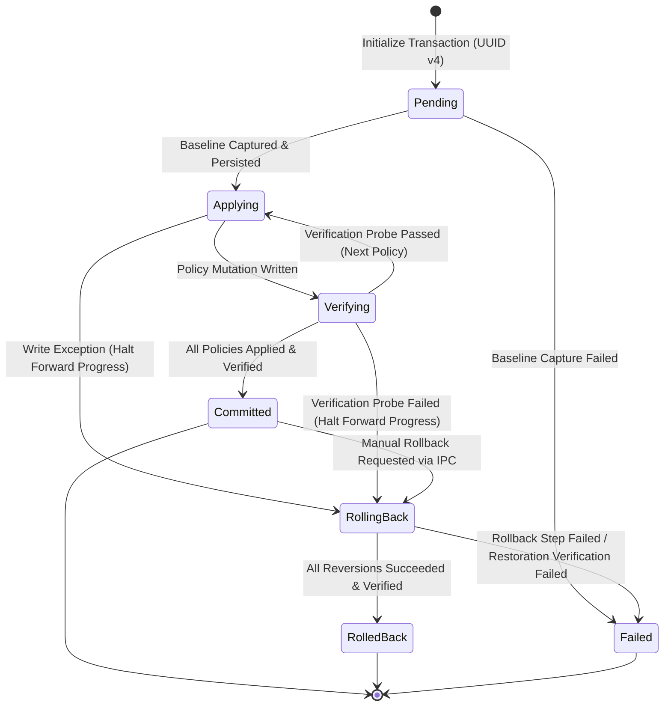
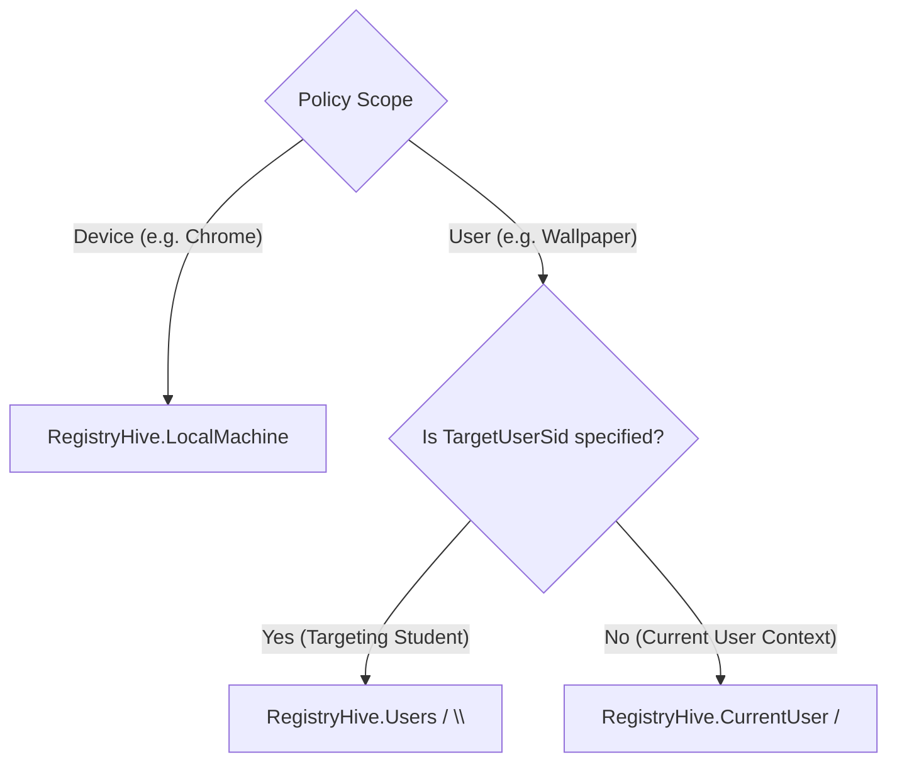
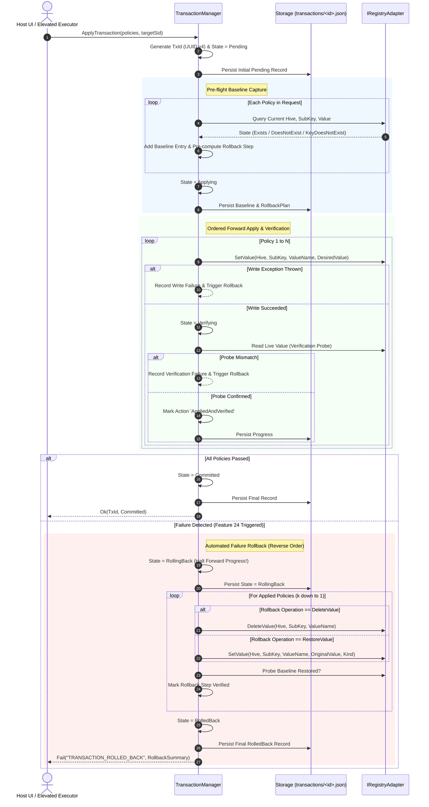

# Technical Specification & Blueprint: Baseline & Transaction Capture (Feature 23) and Automated Failure Rollback (Feature 24)

**Agent ID:** `explorer_m3_3`  
**Milestone:** Milestone 3 (First Functional Policy Engine)  
**Parent Caller:** `12bf6eae78a7fe11007f4aea28270901` (Project Orchestrator)  
**Status:** COMPLETE / READY FOR WORKER IMPLEMENTATION  
**Target File:** `/home/antigravity/krrozino/winlab/.agents/teamwork/explorer_m3_3/handoff.md`  
**Date:** 2026-11-10  

---

## 1. Executive Summary & Problem Analysis

In Milestone 3, WinLab Desktop transitions from read-only system inspection and mock previews to its **First Functional Policy Engine**. While earlier prototypes in `src/lib/generator.ts` generated monolithic PowerShell scripts with rudimentary recovery blocks, Milestone 3 establishes an enterprise-grade, transaction-safe execution architecture implemented directly in .NET 10 LTS (`WinLab.Contracts` and `WinLab.Executor`) with strict TypeScript IPC mirror contracts.

### Scope of this Investigation
- **Feature 23 (Baseline & Transaction Capture):**
  - Pre-flight snapshot of every target registry hive, subkey, value name, value type, and raw data prior to applying any system modification.
  - Strict tracking of pre-existing vs non-existing registry keys and values (`DoesNotExist`, `KeyDoesNotExist`, `Exists`) to guarantee that reverting a policy removes newly introduced values rather than defaulting them to `0` or blank.
  - Unique transaction identifier generation (UUID v4) and transaction log persistence in structured JSON format (`C:\ProgramData\WinLab\transactions\<TxId>.json`) with cross-platform fallback for automated Linux CI testing.
- **Feature 24 (Automated Failure Rollback):**
  - Ordered, sequential policy application with immediate verification probe execution after each policy mutation.
  - **Zero Unverified Forward Progress:** If any mutation fails to apply or fails its verification probe, forward progress halts immediately.
  - Automated failure rollback executed in strict reverse order of applied mutations, restoring original values or deleting created keys.
  - Re-probing of the registry to confirm baseline restoration, recording terminal status (`RolledBack` or `Failed`), and returning structured failure diagnostics via IPC without crashing or leaving the operating system in a corrupt/half-applied state.

---

## 2. Transaction Management Architecture & State Machine (Task 1)

### 2.1 State Machine Lifecycle



### 2.2 Transaction States Specification

| State | Description | Invariants & Transition Triggers |
| :--- | :--- | :--- |
| `Pending` | Initial state upon transaction creation. | UUID v4 assigned; pre-flight registry probe captures baseline; initial `<TxId>.json` written to disk. |
| `Applying` | Forward mutation in progress. | Sequentially iterating through policy items; writing registry values via `IRegistryAdapter`. |
| `Verifying` | Active verification probe. | Executes read-only probe immediately following a policy apply; confirms registry value, type, and presence. |
| `Committed` | Successful completion. | All policies in transaction batch successfully applied and verified; terminal success state. |
| `RollingBack` | Reversion in progress. | Triggered automatically on apply/verify failure OR manually via `policy.rollback_transaction`. Forward progress halted; walking reverse-order rollback plan. |
| `RolledBack` | Successful rollback. | All applied mutations restored or deleted, and re-probed to confirm baseline restoration; terminal recovered state. |
| `Failed` | Terminal unrecoverable error. | Baseline capture failed, disk write corrupted, or rollback failed to restore baseline state. |

---

## 3. Transaction Log Persistence & Schema (Task 1)

### 3.1 Path Resolution & File System Storage
- **Windows Production Path:**  
  `C:\ProgramData\WinLab\transactions\<TransactionId>.json`  
  Protected by Win32 DACL (SYSTEM: Full Control, Administrators: Full Control, Users: Read-Only).
- **Cross-Platform / Linux Testing Fallback:**  
  When running in Linux test runners or development environments:
  ```csharp
  public static string ResolveTransactionDirectory(string? overridePath = null)
  {
      if (!string.IsNullOrWhiteSpace(overridePath))
          return overridePath;

      string? env = Environment.GetEnvironmentVariable("WINLAB_TRANSACTION_DIR");
      if (!string.IsNullOrWhiteSpace(env))
          return env;

      if (OperatingSystem.IsWindows())
      {
          return Path.Combine(Environment.GetFolderPath(Environment.SpecialFolder.CommonApplicationData), "WinLab", "transactions");
      }

      return Path.Combine(Environment.GetFolderPath(Environment.SpecialFolder.UserProfile), ".winlab", "transactions");
  }
  ```
- **Atomic File Writing Pattern:**  
  To prevent partial or corrupted transaction files during unexpected system reboots or process termination, writes MUST write to `<TransactionId>.json.tmp` and execute an atomic file move/replace (`File.Move(tmp, dest, overwrite: true)`).

### 3.2 Canonical Transaction Schema (`<TransactionId>.json`)

```json
{
  "transactionId": "a87e5b22-83b6-4b20-92a4-79fa69910d54",
  "version": "1.0.0",
  "createdAt": "2026-11-10T23:20:00.100Z",
  "updatedAt": "2026-11-10T23:20:01.350Z",
  "status": "Committed",
  "targetUserName": "Aluno",
  "targetUserSid": "S-1-5-21-123456789-123456789-123456789-1001",
  "failure": null,
  "baseline": {
    "capturedAt": "2026-11-10T23:20:00.150Z",
    "entries": [
      {
        "policyId": "wallpaper_lock",
        "hive": "CurrentUser",
        "subKey": "Software\\Microsoft\\Windows\\CurrentVersion\\Policies\\ActiveDesktop",
        "valueName": "NoChangingWallPaper",
        "state": "DoesNotExist",
        "valueKind": null,
        "originalValue": null
      },
      {
        "policyId": "chrome_incognito_lock",
        "hive": "LocalMachine",
        "subKey": "Software\\Policies\\Google\\Chrome",
        "valueName": "IncognitoModeAvailability",
        "state": "Exists",
        "valueKind": "DWord",
        "originalValue": 0
      }
    ]
  },
  "actions": [
    {
      "sequence": 1,
      "policyId": "wallpaper_lock",
      "hive": "CurrentUser",
      "subKey": "Software\\Microsoft\\Windows\\CurrentVersion\\Policies\\ActiveDesktop",
      "valueName": "NoChangingWallPaper",
      "valueKind": "DWord",
      "appliedValue": 1,
      "appliedAt": "2026-11-10T23:20:00.800Z",
      "verifiedAt": "2026-11-10T23:20:00.820Z",
      "status": "AppliedAndVerified"
    },
    {
      "sequence": 2,
      "policyId": "chrome_incognito_lock",
      "hive": "LocalMachine",
      "subKey": "Software\\Policies\\Google\\Chrome",
      "valueName": "IncognitoModeAvailability",
      "valueKind": "DWord",
      "appliedValue": 1,
      "appliedAt": "2026-11-10T23:20:01.100Z",
      "verifiedAt": "2026-11-10T23:20:01.120Z",
      "status": "AppliedAndVerified"
    }
  ],
  "rollbackPlan": [
    {
      "sequence": 1,
      "policyId": "chrome_incognito_lock",
      "operation": "RestoreValue",
      "hive": "LocalMachine",
      "subKey": "Software\\Policies\\Google\\Chrome",
      "valueName": "IncognitoModeAvailability",
      "restoreKind": "DWord",
      "restoreValue": 0,
      "executedAt": null,
      "verifiedAt": null,
      "status": "Pending"
    },
    {
      "sequence": 2,
      "policyId": "wallpaper_lock",
      "operation": "DeleteValue",
      "hive": "CurrentUser",
      "subKey": "Software\\Microsoft\\Windows\\CurrentVersion\\Policies\\ActiveDesktop",
      "valueName": "NoChangingWallPaper",
      "restoreKind": null,
      "restoreValue": null,
      "executedAt": null,
      "verifiedAt": null,
      "status": "Pending"
    }
  ]
}
```

---

## 4. Baseline Capture: Pre-Flight Snapshot Engine (Task 2)

### 4.1 Tri-State Baseline Capture Invariant
When querying a registry setting prior to apply, the system MUST distinguish between three distinct baseline states:
1. `KeyDoesNotExist`: The subkey (e.g. `Software\Microsoft\Windows\CurrentVersion\Policies\ActiveDesktop`) does NOT exist.
2. `DoesNotExist`: The subkey exists, but the target value name (`NoChangingWallPaper`) does NOT exist.
3. `Exists`: The subkey and value name both exist; capture `RegistryValueKind` and exact current data.

> [!CAUTION]
> **The Zero-Defaulting Trap:** If a registry policy was absent prior to configuration, rollback MUST NOT write `0` or an empty string! Many Windows Group Policies treat the presence of a value set to `0` differently from its absence (or keep UI elements disabled). Rollback for `DoesNotExist` and `KeyDoesNotExist` MUST execute `DeleteValue` so the registry is returned to its pristine unmanaged state.

### 4.2 Target Hive and SID Resolution



### 4.3 Pre-computed Reverse Rollback Plan
During the baseline capture phase, the transaction engine immediately synthesizes the inverted `RollbackPlan`:
- For baseline `Exists` -> Create `RollbackOperation.RestoreValue` with `originalValue` and `valueKind`.
- For baseline `DoesNotExist` -> Create `RollbackOperation.DeleteValue`.
- For baseline `KeyDoesNotExist` -> Create `RollbackOperation.DeleteValue` (and mark key for pruning if empty).
- The rollback plan is sequenced in **reverse order** of application: if policies are applied in order $1 \dots N$, the rollback plan orders them $N \dots 1$.

---

## 5. Atomic Apply Sequence & Automated Failure Rollback (Task 3 / Feature 24)

### 5.1 Step-by-Step Execution Sequence



### 5.2 Failure Injection & Invariant Guarantees
1. **Immediate Forward Progress Halt:**  
   If Policy 3 of 5 fails, Policy 4 and Policy 5 are **never executed**.
2. **Reverse Order Restoration:**  
   Policy 2 is rolled back first, followed by Policy 1.
3. **Restoration Verification Probe:**  
   After reverting each item, the probe verifies that the registry matches the baseline snapshot. If the probe confirms restoration, the step is marked `RolledBackAndVerified`.
4. **Structured Error Contract:**  
   The response returns `success: false`, `errorCode: "TRANSACTION_ROLLED_BACK"`, identifying `failedPolicyId`, `failureReason`, and confirming that all previously applied mutations were reverted.

---

## 6. IPC Bridge Integration & Wire Protocols (Task 4)

### 6.1 Action Names & Allowlist
The following actions must be added to `IpcConstants.cs` and `contracts.ts`:
- `policy.apply_transaction`: Executes an atomic, baseline-backed policy batch.
- `policy.rollback_transaction`: Manually rolls back a previously committed transaction by ID.
- `policy.query_status`: Queries the current or latest transaction execution status.

### 6.2 Typed DTOs and Envelopes

#### 1. Command `policy.apply_transaction`
**Request Envelope:**
```json
{
  "id": "e2f7b892-4f10-4c78-b118-2f168d27a412",
  "version": "1.0.0",
  "timestamp": "2026-11-10T23:25:00.000Z",
  "type": "command",
  "action": "policy.apply_transaction",
  "payload": {
    "transactionId": "a87e5b22-83b6-4b20-92a4-79fa69910d54",
    "targetUserName": "Aluno",
    "targetUserSid": "S-1-5-21-123456789-123456789-123456789-1001",
    "policies": [
      { "policyId": "wallpaper_lock", "desiredState": "Blocked" },
      { "policyId": "sounds_lock", "desiredState": "Blocked" },
      { "policyId": "mouse_pointers_lock", "desiredState": "Blocked" },
      { "policyId": "chrome_incognito_lock", "desiredState": "Blocked" },
      { "policyId": "chrome_guest_lock", "desiredState": "Blocked" }
    ]
  }
}
```

**Success Response Envelope (`Committed`):**
```json
{
  "id": "c1a084df-911e-4509-90d2-9214757c3e1e",
  "replyToId": "e2f7b892-4f10-4c78-b118-2f168d27a412",
  "success": true,
  "data": {
    "transactionId": "a87e5b22-83b6-4b20-92a4-79fa69910d54",
    "status": "Committed",
    "appliedCount": 5,
    "failedPolicyId": null,
    "rolledBackCount": 0,
    "message": "All 5 policies successfully applied, verified, and committed."
  }
}
```

**Failure Response Envelope with Automated Rollback (`RolledBack`):**
```json
{
  "id": "d4e21a88-6c8f-4d22-9e55-321456789abc",
  "replyToId": "e2f7b892-4f10-4c78-b118-2f168d27a412",
  "success": false,
  "errorCode": "TRANSACTION_ROLLED_BACK",
  "error": "Policy application failed at 'mouse_pointers_lock': verification probe mismatch. Automated rollback successfully restored 2 preceding policies to baseline.",
  "data": {
    "transactionId": "a87e5b22-83b6-4b20-92a4-79fa69910d54",
    "status": "RolledBack",
    "failedPolicyId": "mouse_pointers_lock",
    "failureReason": "Verification probe expected 1, found 0",
    "appliedCount": 2,
    "rolledBackCount": 2,
    "message": "System baseline restored."
  }
}
```

#### 2. Command `policy.rollback_transaction`
**Request Envelope:**
```json
{
  "id": "f5a12345-6789-4abc-def0-123456789abc",
  "version": "1.0.0",
  "timestamp": "2026-11-10T23:30:00.000Z",
  "type": "command",
  "action": "policy.rollback_transaction",
  "payload": {
    "transactionId": "a87e5b22-83b6-4b20-92a4-79fa69910d54"
  }
}
```

**Response Envelope:**
```json
{
  "id": "89ab12cd-ef34-5678-90ab-cdef12345678",
  "replyToId": "f5a12345-6789-4abc-def0-123456789abc",
  "success": true,
  "data": {
    "transactionId": "a87e5b22-83b6-4b20-92a4-79fa69910d54",
    "status": "RolledBack",
    "restoredCount": 5,
    "message": "Transaction a87e5b22-83b6-4b20-92a4-79fa69910d54 was successfully reverted to baseline."
  }
}
```

#### 3. Query `policy.query_status`
**Request Envelope:**
```json
{
  "id": "11223344-5566-7788-9900-aabbccddeeff",
  "version": "1.0.0",
  "timestamp": "2026-11-10T23:35:00.000Z",
  "type": "query",
  "action": "policy.query_status",
  "payload": {
    "transactionId": "a87e5b22-83b6-4b20-92a4-79fa69910d54"
  }
}
```

---

## 7. Registry Footprint of Milestone 3 Policies (Features 18–22)

The 5 low-risk policies implemented in Milestone 3 have exact registry specifications:

| Feature | Policy ID | Hive | SubKey | ValueName | ValueKind | Desired Value (Blocked) | Verification Probe | Rollback Operation |
| :--- | :--- | :--- | :--- | :--- | :--- | :--- | :--- | :--- |
| **F18** | `wallpaper_lock` | `HKCU` (or `HKU\<SID>`) | `Software\Microsoft\Windows\CurrentVersion\Policies\ActiveDesktop` | `NoChangingWallPaper` | `DWord` | `1` | Value == `1` | `DeleteValue` or restore original |
| **F19** | `sounds_lock` | `HKCU` (or `HKU\<SID>`) | `Software\Policies\Microsoft\Windows\Personalization` | `NoChangingSoundScheme` | `DWord` | `1` | Value == `1` | `DeleteValue` or restore original |
| **F20** | `mouse_pointers_lock` | `HKCU` (or `HKU\<SID>`) | `Software\Policies\Microsoft\Windows\Personalization` | `NoChangingMousePointers` | `DWord` | `1` | Value == `1` | `DeleteValue` or restore original |
| **F21** | `chrome_incognito_lock` | `HKLM` (or `HKCU`) | `Software\Policies\Google\Chrome` | `IncognitoModeAvailability` | `DWord` | `1` (1 = Disabled) | Value == `1` | `DeleteValue` or restore original |
| **F22** | `chrome_guest_lock` | `HKLM` (or `HKCU`) | `Software\Policies\Google\Chrome` | `BrowserGuestModeEnabled` | `DWord` | `0` (0 = Disabled) | Value == `0` | `DeleteValue` or restore original |

---

## 8. Cross-Platform Abstraction & Architecture Specification

To allow 100% automated test verification in CI (Linux) and prevent any hostile manipulation of local workstations during developer testing, registry operations are decoupled behind `IRegistryAdapter`.

### 8.1 `IRegistryAdapter` Interface Definition
File: `desktop/src/WinLab.Contracts/Transactions/IRegistryAdapter.cs`

```csharp
using System;

namespace WinLab.Contracts.Transactions
{
    public enum RegistryHiveType
    {
        CurrentUser,
        LocalMachine,
        Users
    }

    public enum RegistryValueType
    {
        DWord,
        String,
        ExpandString,
        Binary,
        MultiString,
        QWord
    }

    public interface IRegistryAdapter
    {
        bool KeyExists(RegistryHiveType hive, string subKey);
        bool ValueExists(RegistryHiveType hive, string subKey, string valueName);
        RegistryValueType? GetValueKind(RegistryHiveType hive, string subKey, string valueName);
        object? GetValue(RegistryHiveType hive, string subKey, string valueName);
        void SetValue(RegistryHiveType hive, string subKey, string valueName, object value, RegistryValueType valueType);
        void DeleteValue(RegistryHiveType hive, string subKey, string valueName);
        void DeleteKey(RegistryHiveType hive, string subKey);
        string[] GetSubKeyNames(RegistryHiveType hive, string subKey);
        string[] GetValueNames(RegistryHiveType hive, string subKey);
    }
}
```

### 8.2 `InMemoryRegistryAdapter` (For CI & Linux Testing)
File: `desktop/src/WinLab.Contracts/Transactions/InMemoryRegistryAdapter.cs`
- In-memory dictionary backing: `Dictionary<(RegistryHiveType Hive, string SubKey, string ValueName), (RegistryValueType Kind, object Value)>`.
- Supports test failure simulation hooks:
  - `SetFaultInjectionOnWrite(string valueName, Exception ex)`
  - `SetFaultInjectionOnProbe(string valueName, bool failProbe)`
- Fully supports concurrency and resets cleanly between test executions.

### 8.3 `WindowsRegistryAdapter` (For Live Windows Workstations)
File: `desktop/src/WinLab.Contracts/Transactions/WindowsRegistryAdapter.cs`
- Uses `Microsoft.Win32.RegistryKey` and `RegistryHive` mapping.
- Validated with `OperatingSystem.IsWindows()` check.

---

## 9. Implementation Blueprint for Worker

The worker will create and update the following files:

### 9.1 New C# Files to Create in `desktop/src/WinLab.Contracts/Transactions/`

1. `desktop/src/WinLab.Contracts/Transactions/TransactionEnums.cs`:
   - `TransactionStatus` (`Pending`, `Applying`, `Verifying`, `Committed`, `RollingBack`, `RolledBack`, `Failed`).
   - `BaselineValueState` (`Exists`, `DoesNotExist`, `KeyDoesNotExist`).
   - `RollbackOperationType` (`RestoreValue`, `DeleteValue`, `DeleteKeyIfEmpty`).
   - `PolicyActionStatus` (`Pending`, `Applied`, `AppliedAndVerified`, `Failed`, `RolledBack`).

2. `desktop/src/WinLab.Contracts/Transactions/TransactionModels.cs`:
   - `BaselineEntryDto`
   - `TransactionBaselineDto`
   - `PolicyActionRecordDto`
   - `RollbackStepDto`
   - `TransactionRecordDto`
   - `ApplyTransactionRequestDto`
   - `ApplyTransactionResultDto`
   - `RollbackTransactionRequestDto`
   - `RollbackTransactionResultDto`

3. `desktop/src/WinLab.Contracts/Transactions/IRegistryAdapter.cs`:
   - Interface definition as specified in Section 8.1.

4. `desktop/src/WinLab.Contracts/Transactions/InMemoryRegistryAdapter.cs`:
   - Thread-safe in-memory adapter with failure injection capabilities.

5. `desktop/src/WinLab.Contracts/Transactions/WindowsRegistryAdapter.cs`:
   - Windows native implementation using `Microsoft.Win32.RegistryKey`.

6. `desktop/src/WinLab.Contracts/Transactions/ITransactionManager.cs`:
   - `Task<ApplyTransactionResultDto> ApplyTransactionAsync(ApplyTransactionRequestDto request, CancellationToken ct = default)`
   - `Task<RollbackTransactionResultDto> RollbackTransactionAsync(string transactionId, CancellationToken ct = default)`
   - `Task<TransactionRecordDto?> GetTransactionAsync(string transactionId, CancellationToken ct = default)`
   - `Task<List<TransactionRecordDto>> ListTransactionsAsync(CancellationToken ct = default)`

7. `desktop/src/WinLab.Contracts/Transactions/TransactionManager.cs`:
   - Complete implementation of the state machine, baseline capture, reverse rollback, atomic file persistence, and verification probes.

### 9.2 Updates to Existing Files

1. `desktop/src/WinLab.Contracts/IpcConstants.cs`:
   - Add:
     ```csharp
     public const string ActionApplyTransaction = "policy.apply_transaction";
     public const string ActionRollbackTransaction = "policy.rollback_transaction";
     public const string ActionQueryPolicyStatus = "policy.query_status";
     ```
   - Add them to `AllowedActions`.

2. `desktop/src/WinLab.Contracts/SecurityValidator.cs`:
   - Permit `ActionApplyTransaction`, `ActionRollbackTransaction`, `ActionQueryPolicyStatus`.
   - Validate payload schemas for transaction actions.

3. `desktop/src/WinLab.Executor/ExecutorHost.cs`:
   - In `ProcessRequestAsync`, dispatch `ActionApplyTransaction`, `ActionRollbackTransaction`, and `ActionQueryPolicyStatus` to `TransactionManager`.

4. `desktop/src/WinLab.Desktop/Services/RealAgentService.cs`:
   - Support forwarding transaction actions to `ElevatedExecutorClient` (on Windows) or executing via `TransactionManager` (on Linux / non-elevated test mode).

5. `src/desktop/contracts.ts`:
   - Export matching TypeScript interfaces, actions, and status enums.

6. `desktop/tests/WinLab.Tests/TransactionManagerTests.cs`:
   - Comprehensive unit and edge-case tests.

---

## 10. Verification & Test Strategy

### 10.1 Required Test Cases (Worker & Challengers)

| Test Category | Test Case Name | Objective & Invariant |
| :--- | :--- | :--- |
| **State Machine** | `Transaction_HappyPath_CompletesAsCommitted` | Verifies full forward progress from `Pending` -> `Applying` -> `Verifying` -> `Committed`. |
| **Baseline Capture** | `Baseline_Captures_DoesNotExist_WhenValueAbsent` | Confirms that absent keys/values are recorded as `DoesNotExist` and NOT zeroed out. |
| **Baseline Capture** | `Baseline_Captures_OriginalValue_WhenValueExists` | Confirms that pre-existing registry keys preserve original DWORD values. |
| **Rollback Trigger** | `Apply_FailureMidway_TriggersAutomatedRollback` | Applying 5 policies with injected failure on #3 halts progress, rolls back #2 and #1 in reverse order, restores baseline, and transitions state to `RolledBack`. |
| **Probe Verification**| `VerificationProbe_Mismatch_TriggersRollback` | If live registry does not reflect expected value after write, probe failure triggers immediate automated rollback. |
| **Idempotency** | `Rollback_ExecutedTwice_IsIdempotent` | Calling rollback on already rolled-back transaction returns clean success without modifying pristine baseline. |
| **Persistence** | `Transaction_PersistsToDisk_AndReloadsCleanly` | Serializes transaction record to JSON and reloads with 100% schema fidelity. |
| **IPC Security** | `IpcEnvelope_Rejects_InvalidTransactionPayload` | Malformed transaction payloads or shell injections are blocked by `SecurityValidator`. |

---

## 11. Handoff Checklist for Worker

- [ ] Add transaction enums and DTO models to `WinLab.Contracts/Transactions/`.
- [ ] Implement `IRegistryAdapter`, `InMemoryRegistryAdapter`, and `WindowsRegistryAdapter`.
- [ ] Implement `ITransactionManager` and `TransactionManager` with atomic persistence and verification probes.
- [ ] Update `IpcConstants.cs` and `SecurityValidator.cs` to allow `policy.apply_transaction`, `policy.rollback_transaction`, and `policy.query_status`.
- [ ] Wire actions into `ExecutorHost.cs` and `RealAgentService.cs`.
- [ ] Update TypeScript contracts in `src/desktop/contracts.ts`.
- [ ] Add unit test suite in `desktop/tests/WinLab.Tests/TransactionManagerTests.cs`.
- [ ] Verify that `dotnet test` (258+ tests) and `npm test` (95+ tests) pass with 0 errors and 0 warnings.
